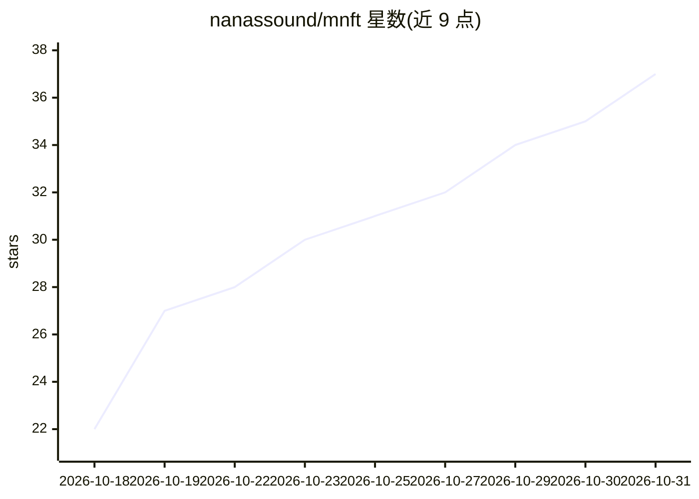

# nanassound/mnft

⭐ 37 · Elixir · Apache-2.0 · 推送 2026-10-28 · [GitHub](https://github.com/nanassound/mnft) · 组织维护

**文本生成 CAD 的 Elixir 工厂线：提示词进，STL/STEP 出**

用户用自然语言描述零件，语言模型编写 CAD 代码，由带防护的解释引擎执行（静态检查、受限解释器、内存/CPU/时钟限制），输出 STL、STEP 与浏览器 3D 预览。核心库 mnft_cad 提供可插拔引擎（build123d 默认、OpenSCAD、alpha 阶段的 smlibpy）、可插拔存储与 BYO-key 多 LLM 提供方；附 Phoenix 参考网页应用与 headless 运行方式。需 Elixir 1.17+、Python 3.11/3.12 与 LLM API key，支持 Docker 部署；README 明确说明引擎非沙箱，暴露公网需内核级隔离。

## 筛选速览

| 维度 | 判定 | 备注 |
|---|---|---|
| AI 角色 | `ai-native` | 本体是模型或模型工具 |
| 许可风险 | `permissive` | Apache-2.0 |
| 部署形态 | `desktop` | 安装包/桌面程序 |
| 模型依赖 | — | README 未给出锁定关系 |
| 硬件要求 | — | 无带数字的原话,不猜 |
| 安装摩擦 | `low` | 无编译、无系统依赖或容器化 |
| 成熟度 | `idea` | |

## 能力要点

- 提示词→LLM 生成 CAD 代码→守护引擎执行，输出 STL/STEP/GLB
- 三种可插拔 CAD 引擎：build123d（默认）、OpenSCAD、smlibpy（alpha）
- BYO-key 多 LLM 提供方，provider/模型均为配置项
- 守护执行机制：静态检查、受限解释器、内存/CPU/时间限制与进程组终止

## 适用场景

- 用自然语言描述零件并生成可加工的 STEP/STL 文件
- 从 PDF 数据手册与照片建模连接器等真实零件
- 将文本生成 CAD 能力嵌入自己的应用（mnft_cad 核心库）

## 场景标签

 · 领域:CAD/制造/生成式AI

## 证据(README 行号)

> L17: the manual labour to something else. You describe a part in plain language.
> L18: A language model writes CAD code. A guarded engine runs it, and you get an
> L19: STL, a STEP file, and a 3D preview you can turn around in your browser.

## 星数曲线

2026-10-18 22 → 2026-10-31 37（+15）

---
*卡片 v1 · prompt 1.4 · 生成 2026-10-26 · 置信度 high · 依据 README sha `3d32d753ba42` · [字段定义](../../DATASET.md)*
