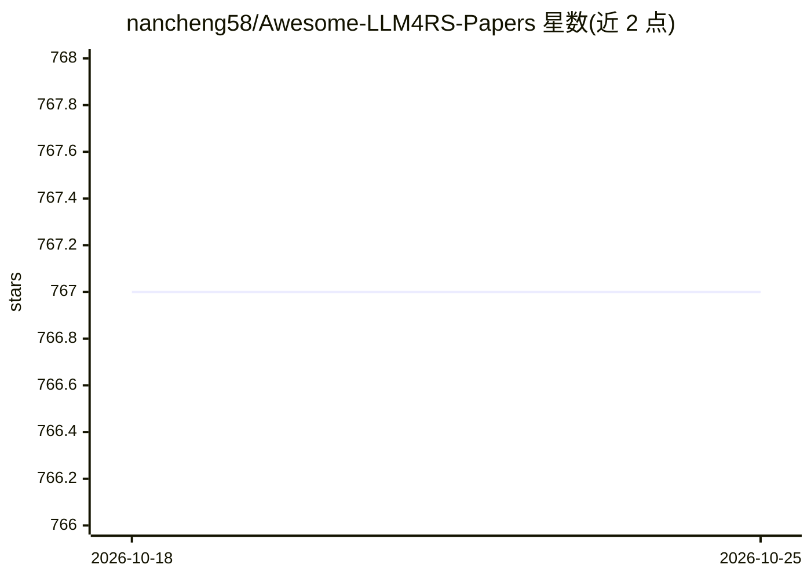

# nancheng58/Awesome-LLM4RS-Papers

⭐ 767 · 推送 2026-03-15 · [GitHub](https://github.com/nancheng58/Awesome-LLM4RS-Papers) · 个人维护

**LLM 增强推荐系统（LLM4RS）论文清单**

收录大语言模型增强推荐系统研究论文的 awesome 清单：先列 5 篇综述（2023-2025，含 arXiv 与期刊论文），随后按条目罗列 70 余篇论文，每条含标题、发表venue与年份，并附 arXiv 或会议论文链接，部分条目附带开源代码仓库链接，覆盖对话推荐、序列推荐、零样本排序、可解释推荐、POI 推荐等方向。通过 issue 与 pull request 接受社区贡献。清单本身不含可运行代码。

## 筛选速览

| 维度 | 判定 | 备注 |
|---|---|---|
| AI 角色 | `ai-knowledge` | 知识聚合/清单类 |
| 许可风险 | `none` | — |
| 部署形态 | `None` |  |
| 模型依赖 | — | README 未给出锁定关系 |
| 硬件要求 | — | 无带数字的原话,不猜 |
| 安装摩擦 | `low` | 无编译、无系统依赖或容器化 |
| 成熟度 | — | 结构信号不足 |

## 能力要点

- 5 篇 LLM4RS 综述 + 70 余篇论文条目
- 每条附论文链接，约 30 条附带代码仓库链接
- 覆盖序列/对话/生成式/可解释/POI 等推荐子方向
- 通过 issue 与 pull request 接受贡献

## 适用场景

- 调研 LLM 用于推荐系统的已有工作
- 为研究选题查找综述与代表性论文
- 根据代码链接复现相关方法

## 场景标签

`精选清单` · 领域:学习与行业

## 证据(README 行号)

> L6: This is a paper list about Large Language Model-enhanced Recommender System. It also contains some related works.
> L12: ## Survey

## 星数曲线

2026-10-18 767 → 2026-10-25 767（+0）

---
*卡片 v1 · prompt 1.4 · 生成 2026-10-22 · 置信度 high · 依据 README sha `3b863049929b` · [字段定义](../../DATASET.md)*
