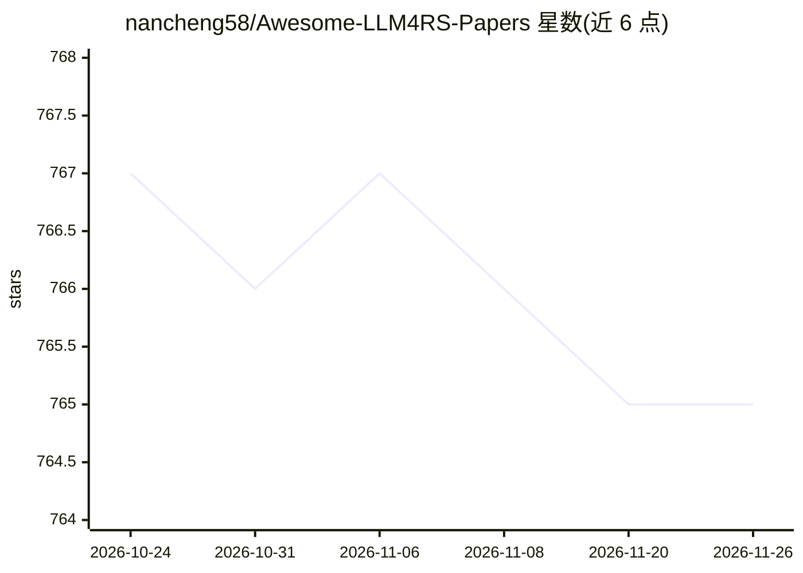

# nancheng58/Awesome-LLM4RS-Papers

⭐ 765 · 推送 2026-11-16 · [GitHub](https://github.com/nancheng58/Awesome-LLM4RS-Papers) · 个人维护

**面向研究者的 LLM 增强推荐系统论文清单**

关于大语言模型增强推荐系统（LLM4RS）的论文汇编，收录 Survey 综述与逐年论文列表，每条附 arxiv/Springer 论文链接，部分条目附开源代码仓库链接，覆盖生成式推荐、对话式推荐、序列推荐、零样本推荐、CTR 预测等方向。仓库接受 issue 与 pull request 补充条目。仅提供链接索引，不含代码实现或运行说明。

## 筛选速览

| 维度 | 判定 | 备注 |
|---|---|---|
| AI 角色 | `ai-knowledge` | 知识聚合/清单类 |
| 许可风险 | `none` | — |
| 部署形态 | `None` |  |
| 模型依赖 | — | README 未给出锁定关系 |
| 硬件要求 | — | 无带数字的原话,不猜 |
| 安装摩擦 | `low` | 无编译、无系统依赖或容器化 |
| 成熟度 | — | 结构信号不足 |

## 能力要点

- Survey 专节收录 5 篇综述
- 论文条目按主题列出，附 arxiv 链接
- 部分条目附 GitHub 代码仓库链接
- 接受 issue/PR 社区补充

## 适用场景

- 查找 LLM 用于推荐系统方向的相关论文
- 调研对话式或生成式推荐的研究进展
- 按论文附带代码链接复现相关工作

## 场景标签

`精选清单` `推荐系统` · 领域:学习与行业

## 证据(README 行号)

> L6: This is a paper list about Large Language Model-enhanced Recommender System. It also contains some related works.
> L12: ## Survey
> L19: ## Paper List

## 星数曲线

2026-10-24 767 → 2026-11-26 765（-2）

---
*卡片 v1 · prompt 1.4 · 生成 2026-11-25 · 置信度 high · 依据 README sha `dd260f2ad33c` · [字段定义](../../DATASET.md)*
