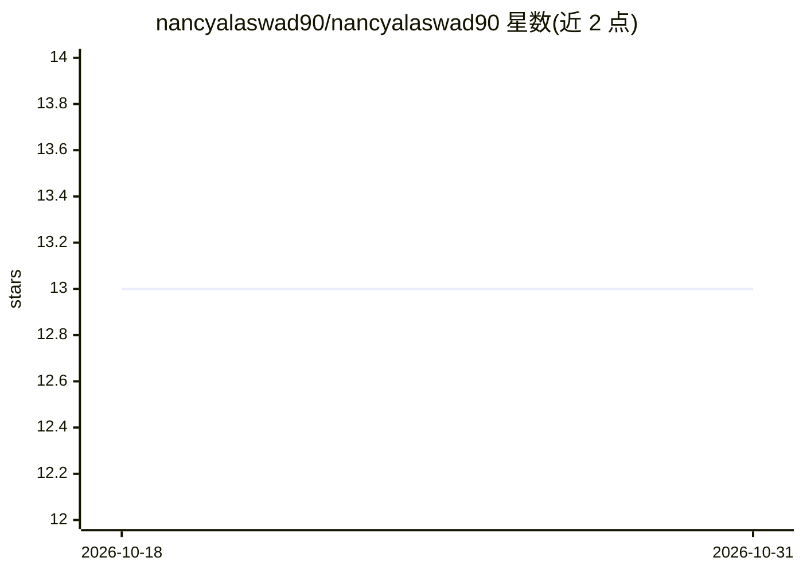

# nancyalaswad90/nancyalaswad90

⭐ 13 · 推送 2026-10-30 · [GitHub](https://github.com/nancyalaswad90/nancyalaswad90) · [官网](https://drive.google.com/file/d/1LTMtY7__7Qco90weyHFY4nEvWWF6cWLW/view) · 个人维护

**个人 GitHub 主页：会计/数据科学背景的学习与认证档案**

Nancy 的 GitHub 个人主页 README，自我介绍为会计学博士候选人，拥有约 12 年银行运营与数据提取分析经验，近年转向数据科学、AI/ML/DL/计算机视觉方向。内容以个人履历为主：在多个大学攻读会计、网络安全、医学检验等学位，担任 Udacity 导师/评审，列出 SQL、Python、Power BI、AWS、Azure 等技能清单，以及 Kaggle、LeetCode、各类奖学金与认证链接。不提供可安装运行的软件产品。

## 筛选速览

| 维度 | 判定 | 备注 |
|---|---|---|
| AI 角色 | `ai-knowledge` | 知识聚合/清单类 |
| 许可风险 | `none` | — |
| 部署形态 | `None` |  |
| 模型依赖 | — | README 未给出锁定关系 |
| 硬件要求 | — | 无带数字的原话,不猜 |
| 安装摩擦 | `low` | 无编译、无系统依赖或容器化 |
| 成熟度 | — | 结构信号不足 |

## 能力要点

- 个人学术与职业履历自述（会计博士候选人、12 年银行经验）
- 技能清单覆盖 SQL、Python、Power BI、AWS、Azure 等
- 汇总 Kaggle、认证、奖学金与求职平台链接

## 适用场景

- 了解维护者的背景与技能方向
- 通过链接访问其学习与认证档案

## 场景标签

 · 领域:个人档案/非软件

## 证据(README 行号)

> L9: > **Nancy** is, a Ph.D. candidate in Accounting with nearly **`12 years`** of experience working in banking operatio
> L29:  - For the past **6 years**, she has applied her expertise in **data science**, working on projects involving advan

## 星数曲线

2026-10-18 13 → 2026-10-31 13（+0）

---
*卡片 v1 · prompt 1.4 · 生成 2026-10-31 · 置信度 mid · 依据 README sha `57e98c4a5e61` · [字段定义](../../DATASET.md)*
