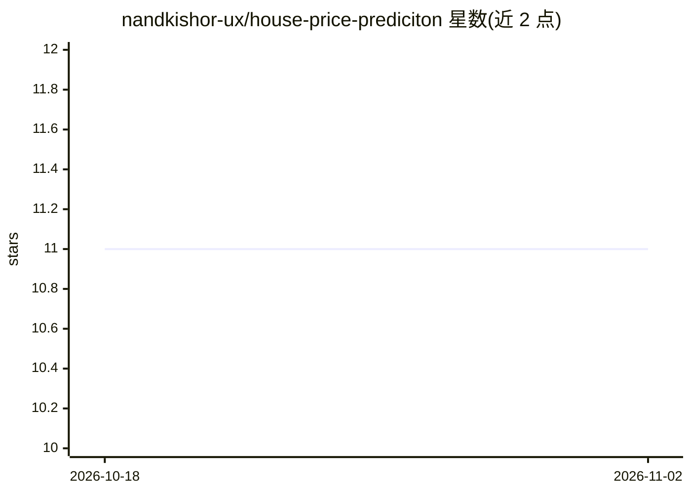

# nandkishor-ux/house-price-prediciton

⭐ 11 · Jupyter Notebook · 推送 2026-07-07 · [GitHub](https://github.com/nandkishor-ux/house-price-prediciton) · 个人维护

**基于房屋特征预测房价的回归机器学习模型**

用 Python 与 Scikit-learn 构建的端到端房价回归项目：加载 Housing 数据集，进行清洗、特征工程与探索性数据分析，编码类别变量（ Furnishing status、main road 等），训练并评估多个回归模型，最终将最优模型用 Joblib 导出为 final_house_price_model.pkl 以便部署复用。主要交付形式为 Jupyter Notebook，另附已保存的 .pkl 模型，可通过 joblib 直接加载对新房屋数据（面积、卧室、卫浴、楼层、停车位、空调、装修状态）做价格预测。

## 筛选速览

| 维度 | 判定 | 备注 |
|---|---|---|
| AI 角色 | `ai-native` | 本体是模型或模型工具 |
| 许可风险 | `none` | — |
| 部署形态 | `None` |  |
| 模型依赖 | — | README 未给出锁定关系 |
| 硬件要求 | — | 无带数字的原话,不猜 |
| 安装摩擦 | `low` | 无编译、无系统依赖或容器化 |
| 成熟度 | — | 结构信号不足 |

## 能力要点

- 完整 ML 流水线：清洗、EDA、编码、多模型训练评估
- 最优模型经 Joblib 导出为 .pkl，可直接部署复用
- 以 Jupyter Notebook 为主体，技术栈为 Python/Scikit-learn/Pandas

## 适用场景

- 根据面积、卧室数等特征估算房价
- 作为回归建模与模型导出部署的学习示例
- 复用保存的 .pkl 模型对新的房屋数据做预测

## 场景标签

 · 领域:机器学习/房价预测

## 证据(README 行号)

> L3: > A regression-based Machine Learning model that predicts property prices based on house features — built end-to-end
> L12: This project builds a complete ML pipeline to estimate house prices based on property features such as area, number

## 星数曲线

2026-10-18 11 → 2026-11-02 11（+0）

---
*卡片 v1 · prompt 1.4 · 生成 2026-11-01 · 置信度 high · 依据 README sha `8e11d855c144` · [字段定义](../../DATASET.md)*
