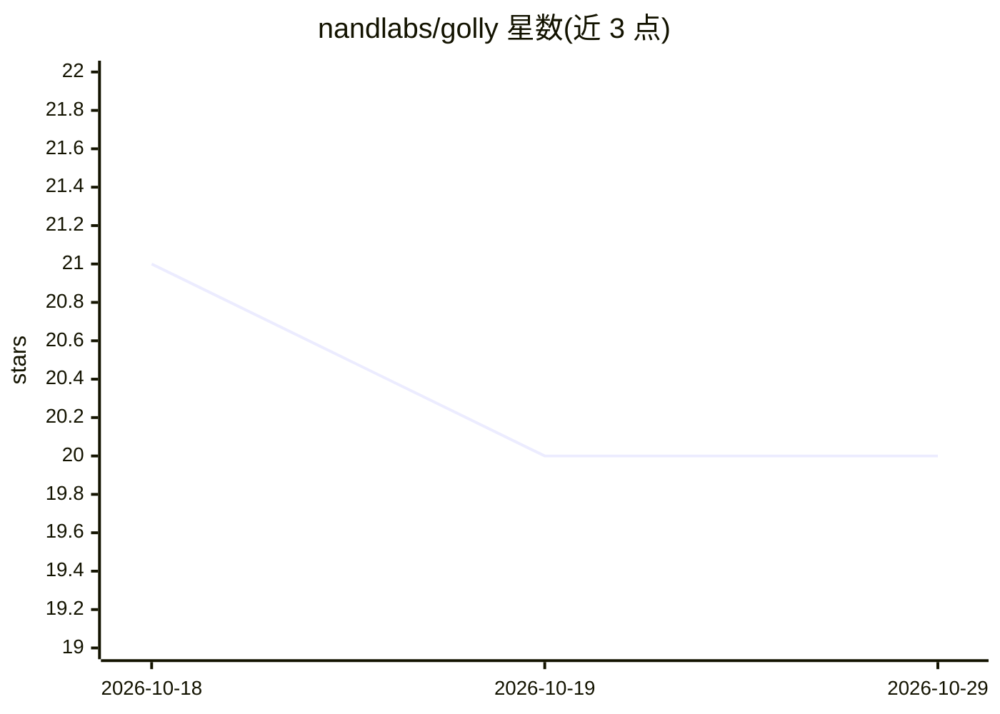

# nandlabs/golly

⭐ 20 · Go · Apache-2.0 · 推送 2026-09-18 · [GitHub](https://github.com/nandlabs/golly) · [官网](https://golly.nandlabs.io) · 组织维护

**Go 语言企业级通用工具库：HTTP/编解码/密钥/GenAI 集成**

面向企业级 Go 软件开发的自包含工具库集合，按包组织：HTTP 客户端/服务端/路由、WebSocket、通用消息接口，JSON/XML/YAML 统一编解码，UUID 与 SemVer 处理，含加密算法与多云密钥存储（AWS/GCP/Vault）的凭证管理，任务调度、VFS、日志等基础设施包。AI 部分提供 provider 无关的 GenAI/LLM 接口，附 OpenAI、Claude、Ollama 实现。另有独立仓库对接 AWS/GCP/Vault 服务。通过 go get 安装。

## 筛选速览

| 维度 | 判定 | 备注 |
|---|---|---|
| AI 角色 | `ai-ecosystem` | LLM/agent 周边工具 |
| 许可风险 | `permissive` | Apache-2.0 |
| 部署形态 | `None` |  |
| 模型依赖 | local-ok | 支持本地模型 |
| 硬件要求 | — | 无带数字的原话,不猜 |
| 安装摩擦 | `low` | 无编译、无系统依赖或容器化 |
| 成熟度 | — | 结构信号不足 |

## 能力要点

- provider 无关的 GenAI/LLM 接口，附 OpenAI/Claude/Ollama 实现
- HTTP 客户端/服务端/路由与 WebSocket（RFC 6455）网络包
- 含加密算法、密钥轮换与多云密钥存储的 secrets 包
- JSON/XML/YAML 统一编解码与任务调度等基础设施包

## 适用场景

- Go 后端服务中复用 HTTP、编解码、调度等通用组件
- 以统一接口切换调用 OpenAI/Claude/Ollama 等 LLM
- 集中管理多云环境的凭证与密钥

## 场景标签

`模型网关` · 领域:Agent 开发

## 证据(README 行号)

> L22: Golly is a self-contained toolkit of common utilities for the Go programming language, designed to simplify and enh
> L72: |genai|Provider-agnostic GenAI/LLM interface with prompt templates and multi-part messages|
> L73: |genai/impl|OpenAI, Claude, and Ollama provider implementations|

## 星数曲线

2026-10-18 21 → 2026-10-29 20（-1）

---
*卡片 v1 · prompt 1.4 · 生成 2026-10-28 · 置信度 high · 依据 README sha `68ae609d2c3c` · [字段定义](../../DATASET.md)*
