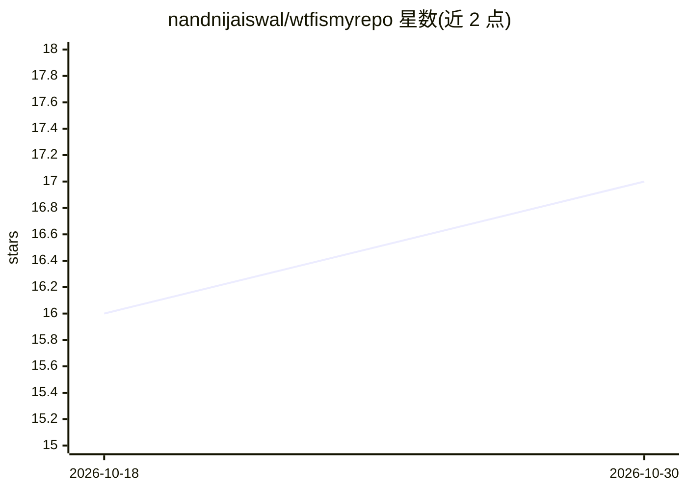

# nandnijaiswal/wtfismyrepo

⭐ 17 · JavaScript · MIT · 推送 2026-07-03 · [GitHub](https://github.com/nandnijaiswal/wtfismyrepo) · 个人维护

**帮新接手者快速摸清代码库结构的 CLI 与 Claude Code 技能**

以 CLI/库与 Claude Code skill 两种形式交付的代码库上手工具。确定性数据引擎解析 import 语句构建依赖图，跑 PageRank 找出承重文件，结合 git churn 计算脆弱性，并通过 gh 读取开放 PR 与 issues 得出热点区和 good first issues。解释层采用 ADHD 发散思维引擎（diverge→score→cluster→deepen），从多个角度生成讲解；未安装 adhd-agent 时打印提示词，由 skill 内 Claude 执行同循环。支持 JS/TS/JSX/Python/Go 的 import 解析，Rust/Java 等在路线图中。

## 筛选速览

| 维度 | 判定 | 备注 |
|---|---|---|
| AI 角色 | `ai-enhanced` | 去掉 AI 部分产品仍成立 |
| 许可风险 | `permissive` | MIT |
| 部署形态 | `library` | 以包/库形式分发 |
| 模型依赖 | — | README 未给出锁定关系 |
| 硬件要求 | — | 无带数字的原话,不猜 |
| 安装摩擦 | `low` | 无编译、无系统依赖或容器化 |
| 成熟度 | `idea` | |

## 能力要点

- import 图 + PageRank 识别承重文件（the spine）
- centrality × git-churn 计算脆弱性，标记 handle-with-care 文件
- 通过 gh 读取开放 PR/合并 PR/issues 生成热点区与 good first issues
- ADHD 发散引擎从多角度生成讲解，取最优角度深化

## 适用场景

- 新加入一个陌生的大型代码库时确定从哪读起
- 接手遗留代码时识别高风险、高变更的文件
- 找可安全上手的第一个任务与 good first issues

## 场景标签

 · 领域:开发者工具/代码分析

## 证据(README 行号)

> L16: Most "explain my code" tools read the code and stop — but code only tells you *what* exists. The *why*, and the *la
> L20: It ships as both a **CLI/library** (the deterministic data engine + ADHD explanation engine) and a **Claude Code sk
> L127: **ADHD engine** (UditAkhourii/adhd, MIT) — `wtfismyrepo explain` packages the analysis as an ADHD problem + contex

## 星数曲线

2026-10-18 16 → 2026-10-30 17（+1）

---
*卡片 v1 · prompt 1.4 · 生成 2026-10-30 · 置信度 high · 依据 README sha `cd9466ba166c` · [字段定义](../../DATASET.md)*
