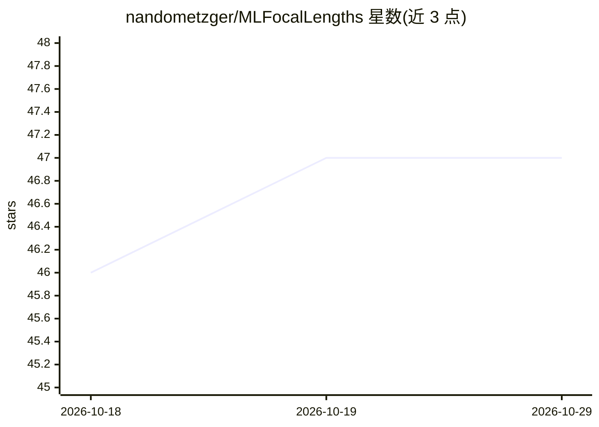

# nandometzger/MLFocalLengths

⭐ 47 · Python · MIT · 推送 2026-08-12 · [GitHub](https://github.com/nandometzger/MLFocalLengths) · 个人维护

**从单张照片估计拍摄焦距的 CNN 模型，无需 EXIF**

基于 EfficientNet-B4（ImageNet 预训练）的 CNN 回归模型，从单张图像预测 35mm 等效焦距，并可通过 EXIF 或用户输入的裁切系数换算物理焦距。附带预训练权重（233 MB，首次运行自动下载）与推理 CLI，支持批量处理、JSON/CSV 输出、将预测写回 EXIF UserComment。训练数据为约 1.5 万张个人照片，留出集平均绝对误差 16 mm。面向需要为缺失 EXIF 的图片恢复焦距信息的摄影/图像处理用户。

## 筛选速览

| 维度 | 判定 | 备注 |
|---|---|---|
| AI 角色 | `ai-native` | 本体是模型或模型工具 |
| 许可风险 | `permissive` | MIT |
| 部署形态 | `library` | 以包/库形式分发 |
| 模型依赖 | — | README 未给出锁定关系 |
| 硬件要求 | — | 无带数字的原话,不猜 |
| 安装摩擦 | `low` | 无编译、无系统依赖或容器化 |
| 成熟度 | — | 结构信号不足 |

## 能力要点

- 单张图像预测焦距，留出集 MAE 16 mm（35mm 等效）
- 输出 35mm 等效与物理焦距，标明裁切系数来源
- 批量递归处理与 JSON/CSV 非交互输出
- 预训练权重首次运行自动下载，一条命令从 clone 到预测

## 适用场景

- 为网络图片、胶片扫描件等丢失 EXIF 的照片补焦距信息
- 批量给照片库标注预测焦距并写回 EXIF
- 对比模型预测与相机记录的 EXIF 焦距

## 场景标签

`图像视频处理` · 领域:感知与多模态

## 证据(README 行号)

> L24: This repository trains a CNN to do exactly that, and ships the pretrained model.
> L28: - 🎯 **16 mm mean absolute error** on a held-out set of real photographs

## 星数曲线

2026-10-18 46 → 2026-10-29 47（+1）

---
*卡片 v1 · prompt 1.4 · 生成 2026-10-25 · 置信度 high · 依据 README sha `1d40f0259893` · [字段定义](../../DATASET.md)*
