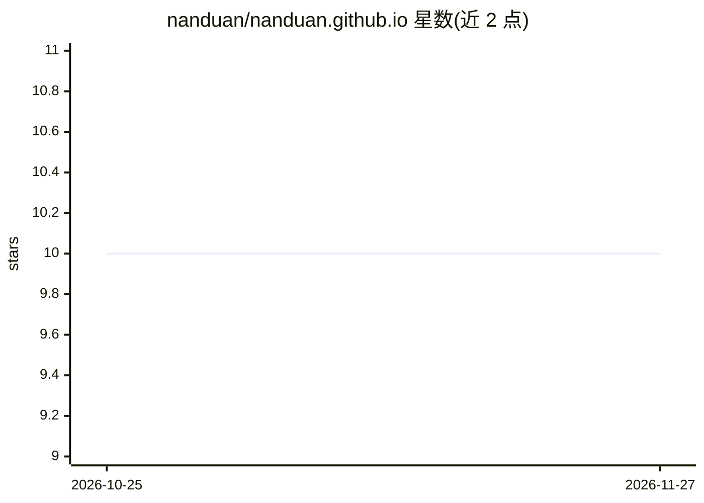

# nanduan/nanduan.github.io

⭐ 10 · SCSS · 推送 2026-11-21 · [GitHub](https://github.com/nanduan/nanduan.github.io) · 个人维护 · 中文 README

**京东副总裁/研究员段楠的个人学术主页**

这是 NLP/AI 研究者段楠的个人介绍页面，非软件项目。内容为个人履历：现任京东副总裁及探索研究院院长，领导语言、语音、视觉、具身智能的基础模型研究；曾任职阶跃星辰与微软亚洲研究院。页面列出代表性研究成果（JoyAI 系列、Step-Video-T2V、scGPT、Visual ChatGPT、NUWA、CodeBERT 等）、学术兼职与学术服务职务、获奖情况，并提供 Google Scholar、LinkedIn 及联系邮箱入口。

## 筛选速览

| 维度 | 判定 | 备注 |
|---|---|---|
| AI 角色 | `ai-knowledge` | 知识聚合/清单类 |
| 许可风险 | `none` | — |
| 部署形态 | `None` |  |
| 模型依赖 | — | README 未给出锁定关系 |
| 硬件要求 | — | 无带数字的原话,不猜 |
| 安装摩擦 | `low` | 无编译、无系统依赖或容器化 |
| 成熟度 | — | 结构信号不足 |

## 能力要点

- 汇总 200 余篇论文的代表性成果清单及发表出处
- 提供 Google Scholar、LinkedIn、邮箱等个人入口
- 中英双语个人履历

## 适用场景

- 了解段楠的研究方向与代表性论文
- 通过页面提供的渠道联系作者

## 场景标签

 · 领域:学术/个人主页

## 证据(README 行号)

> L1: Nan Duan
> L3:  NLP/AI Researcher
> L16: - JoyAI-Echo & JoyAI-Echo-WM (Technical Report, 2026), SoTA audio-video generation & interactive world models.

## 星数曲线

2026-10-25 10 → 2026-11-27 10（+0）

---
*卡片 v1 · prompt 1.4 · 生成 2026-11-19 · 置信度 high · 依据 README sha `91e93b4aa1b2` · [字段定义](../../DATASET.md)*
