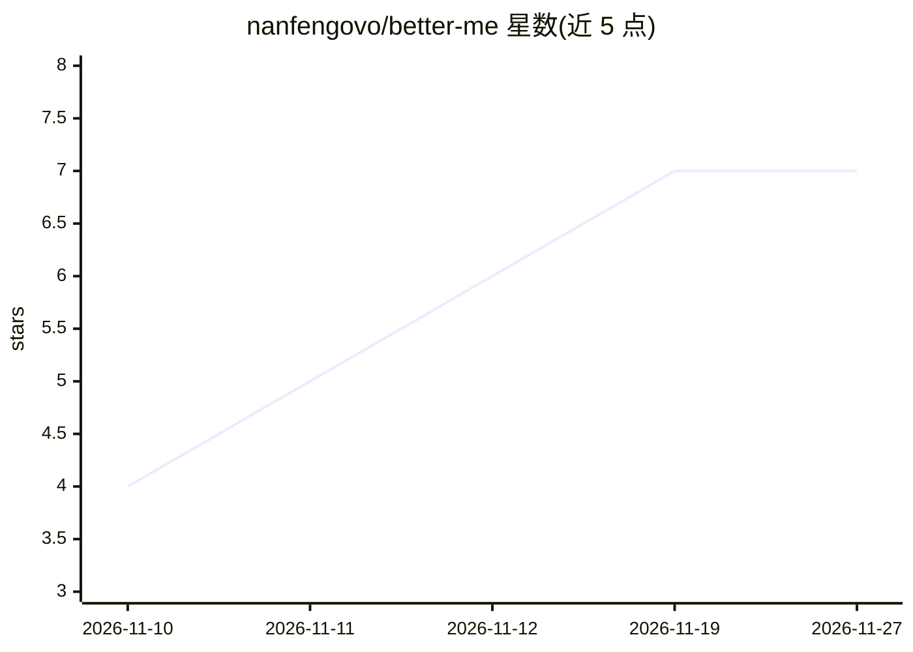

# nanfengovo/better-me

⭐ 7 · TypeScript · 推送 2026-11-26 · [GitHub](https://github.com/nanfengovo/better-me) · [官网](https://nanfengovo.github.io/better-me/) · 个人维护 · 中文 README

**本地优先的简历制作与求职记录工作台，可选接入自有模型**

BetterMe 是一个本地优先的简历与求职工作台：维护一份结构化事实库，派生多份简历，各自选择 119 套模板、10 套主题、语言与排版；支持 PDF/DOCX/图片/Markdown 等格式导入、内容核对、版本历史与差异恢复，并记录岗位收藏、投递与跟进。日常编辑导出不依赖 AI；可选接入 Gemini、OpenAI 兼容服务、DeepSeek 或本地 Ollama 做结构化导入、视觉 OCR 与 JD 诊断，AI 建议需本人核对且不自动写回事实库。

## 筛选速览

| 维度 | 判定 | 备注 |
|---|---|---|
| AI 角色 | `ai-enhanced` | 去掉 AI 部分产品仍成立 |
| 许可风险 | `none` | — |
| 部署形态 | `self-host` | docker 或自建部署 |
| 模型依赖 | local-ok | 支持本地模型 |
| 硬件要求 | — | 无带数字的原话,不猜 |
| 安装摩擦 | `low` | 无编译、无系统依赖或容器化 |
| 成熟度 | — | 结构信号不足 |

## 能力要点

- 119 套版式与 10 套简历 JSON 主题，模板/主题/排版/网页配色分别控制
- 简历导入支持 PDF、DOCX、图片、HTML、Markdown、TXT 与 JSON，含 AI 结构化与视觉 OCR
- 岗位地图与来源工具：四平台单页读取、GitHub 线索、企业招聘入口发现与逐字段薪资核对
- 本地草稿、最近 50 版历史、命名检查点与单项差异恢复

## 适用场景

- 同一份真实履历生成投递不同岗位的多份简历
- 记录岗位来源、投递阶段与跟进材料
- 在本地接入 Ollama 或 DeepSeek 做简历内容核对与 JD 分析

## 场景标签

 · 领域:求职/个人生产力工具

## 证据(README 行号)

> L9: BetterMe 是一个本地优先的简历与求职工作台：从核对履历、制作多份简历，到收藏岗位、记录投递与保存当时的材料，尽量在同一处完成。日常编辑、模板、导出、机会记录与版本管理不依赖 AI；需要时，再连接自己的模型服务。
> L58: |可选 AI|Gemini、OpenAI 兼容服务、DeepSeek、本地 Ollama；结构化导入、视觉 OCR、JD 诊断与表达建议|云请求直达所选服务商；建议需核对，不自动写回 Fact，分数不是录用概率|

## 星数曲线

2026-11-10 4 → 2026-11-27 7（+3）

---
*卡片 v1 · prompt 1.4 · 生成 2026-11-20 · 置信度 high · 依据 README sha `5cf7cecc5d28` · [字段定义](../../DATASET.md)*
