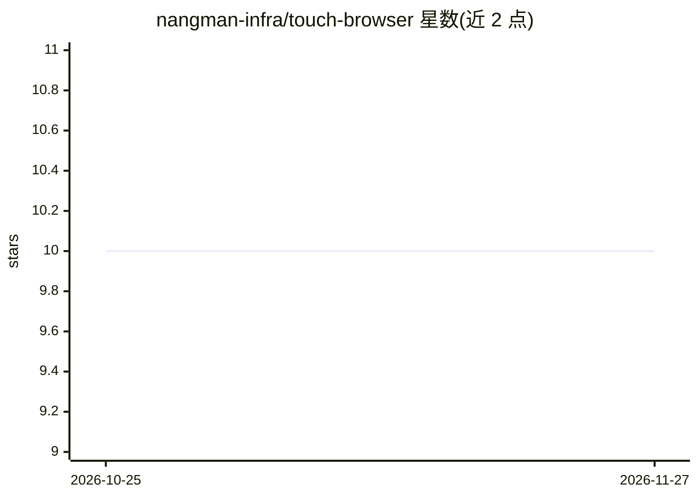

# nangman-infra/touch-browser

⭐ 10 · Rust · MPL-2.0 · 推送 2026-06-15 · [GitHub](https://github.com/nangman-infra/touch-browser) · [官网](https://nangman.cloud) · 组织维护

**为 AI agent 提供网页声明溯源与证据判定的验证层**

面向 AI agent 的证据验证工具：打开网页后编译结构化快照，对提交的声明输出四种判定（支持/矛盾/证据不足/需继续浏览），并给出置信区间、支持片段、判定解释与带 URL 和时间戳的引用。提供 CLI、独立安装包与 MCP 包（@nangman-infra/touch-browser-mcp），可接入 Claude Desktop、Cursor 等 MCP host；浏览器层默认 Playwright 适配器，可选 Rust CDP 路径。判定只覆盖页面局部证据，不做跨页面真值裁决。

## 筛选速览

| 维度 | 判定 | 备注 |
|---|---|---|
| AI 角色 | `ai-native` | 本体是模型或模型工具 |
| 许可风险 | `permissive` | MPL-2.0 |
| 部署形态 | `library` | 以包/库形式分发 |
| 模型依赖 | — | README 未给出锁定关系 |
| 硬件要求 | — | 无带数字的原话,不猜 |
| 安装摩擦 | `medium` | 含编译或系统依赖之一 |
| 成熟度 | — | 结构信号不足 |

## 能力要点

- 对页面声明输出四种判定并附支持片段与引用 URL/时间戳
- MCP 包接入 Claude Desktop、Cursor、Codex 等本地 host
- policy 面板将页面与操作分级为 allow/review/block
- session-synthesize 将多页会话聚合为带引用的 JSON/Markdown

## 适用场景

- 让 agent 回答前核验网页是否支撑其声明
- 事实核查工作流中获取带来源引用的证据片段
- 多页研究会话的可回放审计与引用输出

## 场景标签

`浏览器自动化` `网页抓取` · 领域:效率与自动化

## 证据(README 行号)

> L10: `touch-browser` is an evidence verification layer for AI agents. It does more than fetch a page or convert HTML to 
> L103: - npm package: `@nangman-infra/touch-browser-mcp`
> L278: - `serve`: expose the runtime over stdio JSON-RPC for MCP or agent integration

## 星数曲线

2026-10-25 10 → 2026-11-27 10（+0）

---
*卡片 v1 · prompt 1.4 · 生成 2026-11-19 · 置信度 mid · 依据 README sha `45de06d0f8d9` · [字段定义](../../DATASET.md)*
