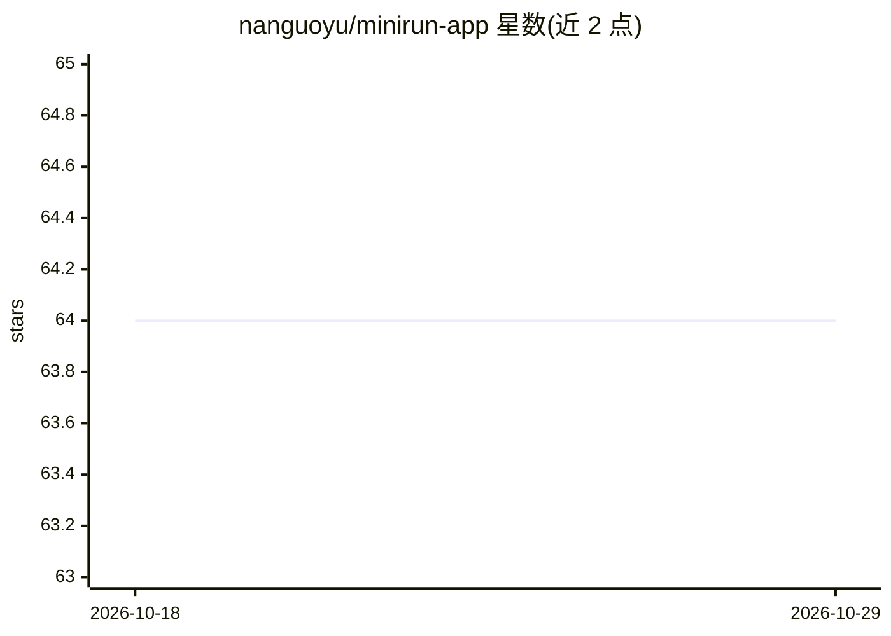

# nanguoyu/minirun-app

⭐ 64 · Swift · Apache-2.0 · 推送 2026-09-12 · [GitHub](https://github.com/nanguoyu/minirun-app) · [官网](https://minirun.dev/) · 个人维护 · 中文 README

**在 Mac/iPhone 上运行超过内存大小的本地大模型的原生应用**

Swift 编写的 macOS 与 iOS 原生应用，运行权重体积远超设备内存的开源模型：逐层、且仅读取路由选中的专家，从外置 NVMe SSD 流式加载到固定缓冲区，交给 MLX 执行后释放。用户可设定内存预算（Floor/Balanced/Generous 或自定数值），运行时拒绝无法兑现的预算。文件在运行前对照 Hugging Face 发布树校验。模型容器以字节保留方式重打包（不重量化）发布。iPhone 端通过 TestFlight 分发，Mac 端提供签名公证的 dmg。速度随硬盘、线缆与预算变化，大模型在 iPhone 上解码较慢（如 Kimi K3 约 220 秒/token）。

## 筛选速览

| 维度 | 判定 | 备注 |
|---|---|---|
| AI 角色 | `ai-native` | 本体是模型或模型工具 |
| 许可风险 | `permissive` | Apache-2.0 |
| 部署形态 | `desktop` | 安装包/桌面程序 |
| 模型依赖 | — | README 未给出锁定关系 |
| 硬件要求 | — | 无带数字的原话,不猜 |
| 安装摩擦 | `medium` | 含编译或系统依赖之一 |
| 成熟度 | — | 结构信号不足 |

## 能力要点

- 逐层+专家选择性流式加载，运行大于内存的模型（如 1.56 TB 的 Kimi K3）
- 用户设定内存预算，运行时拒绝无法兑现的预算，各预算下输出字节一致
- 运行前对照 Hugging Face 发布树做文件摘要校验，仅打开已校验描述符
- 实时 Instruments：解码速率、每 token 读取字节数、内存占用与存储流量

## 适用场景

- 在 Apple 设备上本地运行 DeepSeek、Kimi 等超大模型且不依赖云端
- 通过外置 SSD 存放模型权重，不占用设备内置磁盘
- 为本地推理设定并观察内存预算上限

## 场景标签

`推理引擎` · 领域:训练与推理

## 证据(README 行号)

> L22: Minirun is a native macOS and iOS app that runs open models whose weights are
> L30: - **Bigger than memory.** Kimi K3 (2.8 T parameters, 1.56 TB on disk) runs on
> L25: small, fixed set of buffers, hands them to MLX

## 星数曲线

2026-10-18 64 → 2026-10-29 64（+0）

---
*卡片 v1 · prompt 1.4 · 生成 2026-10-24 · 置信度 high · 依据 README sha `cfb16edb5083` · [字段定义](../../DATASET.md)*
