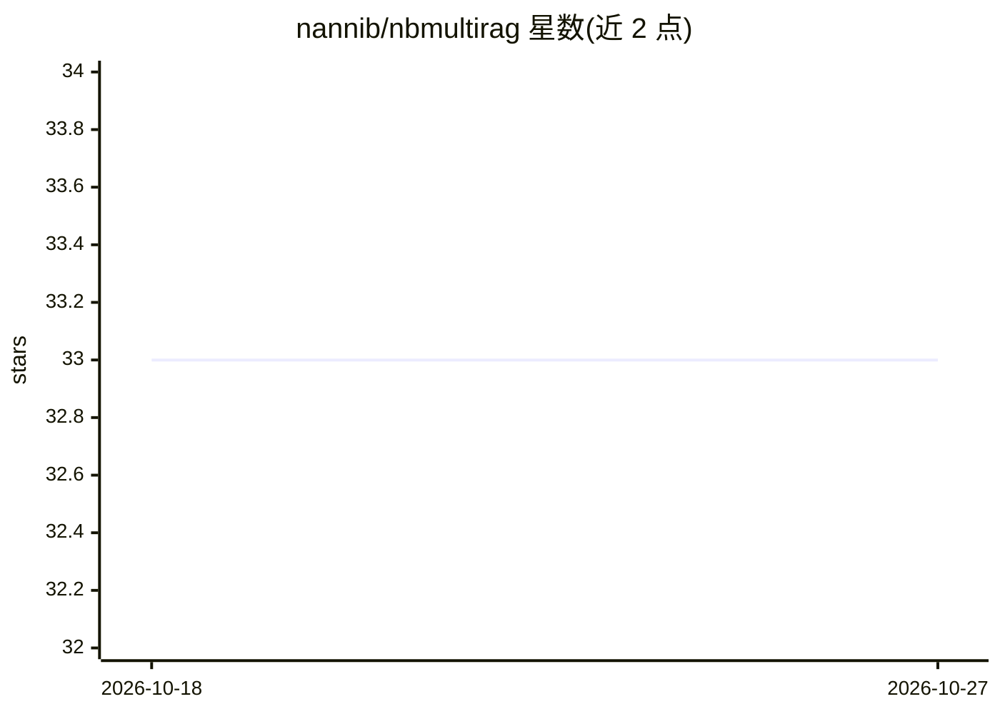

# nannib/nbmultirag

⭐ 33 · Python · GPL-3.0 · 推送 2026-04-14 · [GitHub](https://github.com/nannib/nbmultirag) · 个人维护

**本地多模态 RAG 文档聊天框架（意/英双语）**

基于 Streamlit 的本地 RAG 对话框架，通过 Ollama 下载的 GPT 模型（推荐 Llama 3.2）与用户文档聊天，数据保留在本机。支持索引含音频、视频、图像的文件夹：查询时自动转录音视频、对图片做 OCR、用 BLIP 描述视频中均匀分布的 10 帧；也可上传单文件由系统描述。提供可配置工作区、多 embedder 选择（含意大利语 BERT 模型），仅启动下载 HuggingFace 模型时需联网。Windows 提供 install.bat 一键安装 Tesseract、Ollama 与 FFMpeg，需 Python 3.12.4 手动建 venv 运行。

## 筛选速览

| 维度 | 判定 | 备注 |
|---|---|---|
| AI 角色 | `ai-native` | 本体是模型或模型工具 |
| 许可风险 | `viral` | GPL-3.0 |
| 部署形态 | `library` | 以包/库形式分发 |
| 模型依赖 | local-ok | 支持本地模型 |
| 硬件要求 | — | 无带数字的原话,不猜 |
| 安装摩擦 | `medium` | 含编译或系统依赖之一 |
| 成熟度 | — | 结构信号不足 |

## 能力要点

- 多媒体文档 RAG：音频视频转录、图像 OCR、视频 10 帧描述
- 基于 Ollama 本地模型运行，数据留在本机
- 可创建自定义工作区并自选 embedder（含意大利语/英语 BERT）
- Windows 提供 install.bat 安装 Tesseract、Ollama、FFMpeg

## 适用场景

- 离线与含音频视频图片的本地文档库问答
- 在意大语/英语环境下对混合类型文件做 RAG 检索聊天
- 数据不出本机的私有文档对话

## 场景标签

`聊天机器人` `RAG` `多模态` `文档问答` · 领域:对话与助手

## 证据(README 行号)

> L16: Un framework in Italiano ed Inglese, che permette di chattare con i propri documenti in RAG, anche multimediali (au
> L17: Il framework è una GUI per chattare con un modello GPT scaricato da OLLAMA, si consiglia LLAMA 3.2 (2Gb) perfettame
> L26: 4) Interrogare il sistema, che provvederà a trascrivere gli audio e video presenti nei documenti, fare OCR sulle im

## 星数曲线

2026-10-18 33 → 2026-10-27 33（+0）

---
*卡片 v1 · prompt 1.4 · 生成 2026-10-25 · 置信度 mid · 依据 README sha `783af479373a` · [字段定义](../../DATASET.md)*
