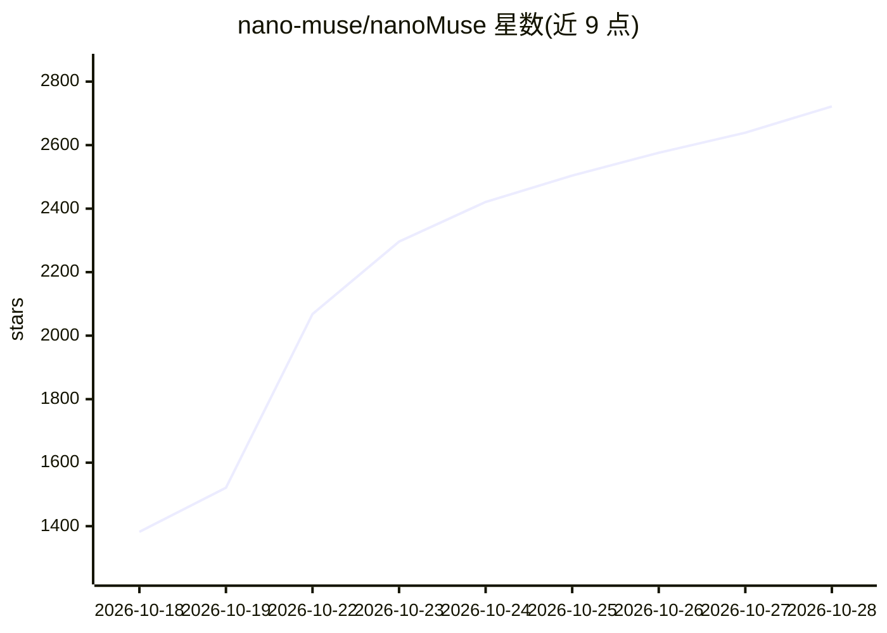

# nano-muse/nanoMuse

⭐ 2,796 · Swift · GPL-3.0 · 推送 2026-10-28 · [GitHub](https://github.com/nano-muse/nanoMuse) · [官网](https://nanomuse.cn/) · 组织维护 · 中文 README

**跨设备个人 agent：一个账号贯通手机/桌面/网页，代做事并跨设备协同**

面向终端用户的开源个人 agent 套件：Android/iOS/桌面/网页应用加一个可自托管的中继组成，GPL-3.0-or-later，由浙江大学团队维护。agent 可通过 Linux shell、浏览器、MCP 与屏幕操作（Hands on）执行任务，删除/发送/支付前暂停询问；任务可跨设备调度（如手机下指令、PC 执行），应用关闭后按计划继续运行；记忆与配置以 Markdown 文件存放。模型来源为社区中继免费额度、21 家提供商的自有 key 或已有订阅（ChatGPT/Claude/Kimi）。桌面端基于 DeepSeek Harness，手机端基于 OpenMinis。

## 筛选速览

| 维度 | 判定 | 备注 |
|---|---|---|
| AI 角色 | `ai-native` | 本体是模型或模型工具 |
| 许可风险 | `viral` | GPL-3.0 |
| 部署形态 | `desktop` | 安装包/桌面程序 |
| 模型依赖 | locked-api |  |
| 硬件要求 | — | 无带数字的原话,不猜 |
| 安装摩擦 | `low` | 无编译、无系统依赖或容器化 |
| 成熟度 | — | 结构信号不足 |

## 能力要点

- 跨设备：手机/桌面/网页共享一个账号与对话，任务可跨设备派发
- 执行能力覆盖 shell、浏览器、MCP、技能与屏幕操作（截图式 GUI 操控）
- 不可逆操作前暂停询问，登录与验证码交还用户
- 中继可自托管，对话文本经中继、文件与截图留在本地设备

## 适用场景

- 让一个 agent 替我在手机和电脑上完成实际任务
- 手机上发指令、家里服务器或 PC 执行的跨设备自动化
- 在飞书/钉钉/企业微信/Telegram 中使用同一个 agent
- 完全自托管：自己的中继加自己的模型 key

## 场景标签

`AI 助手` `GUI 自动化` `浏览器自动化` · 领域:效率与自动化

## 证据(README 行号)

> L27: **nanoMuse is an open-source personal agent for every device you own.** One agent with a name and a look of its own
> L66:  Does things. A Linux shell, a browser, MCP servers and skills, and, with Hands on, the apps on your phone and the 
> L76:  Any model. The relay's allowance, your own key at one of twenty-one providers (Bailian, OpenRouter, OpenAI, Gemini

## 星数曲线

2026-10-18 1,382 → 2026-10-28 2,722（+1,340）

---
*卡片 v1 · prompt 1.4 · 生成 2026-10-21 · 置信度 high · 依据 README sha `3f3f868d0739` · [字段定义](../../DATASET.md)*
