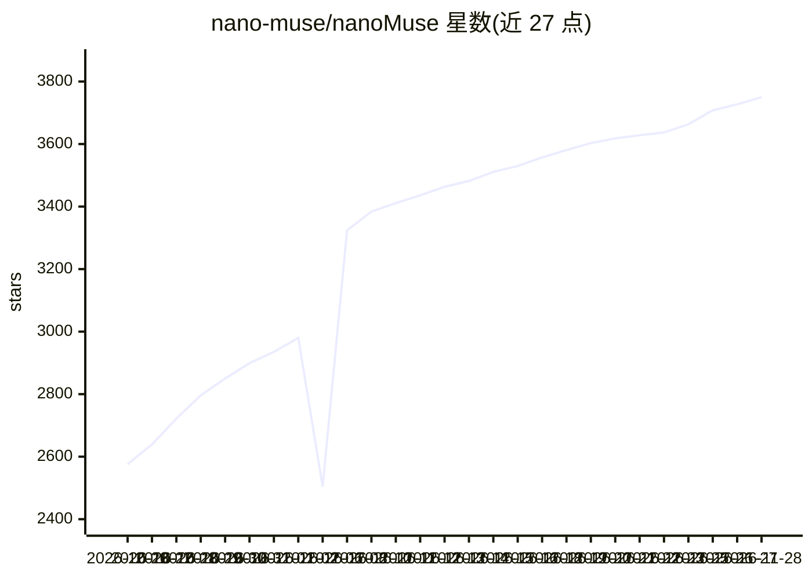

# nano-muse/nanoMuse

⭐ 3,750 · Kotlin · GPL-3.0 · 推送 2026-11-27 · [GitHub](https://github.com/nano-muse/nanoMuse) · [官网](https://nanomuse.cn/) · 个人维护 · 中文 README

**跨手机/桌面/浏览器的开源个人 agent，替你执行任务**

一个跨设备的开源个人 agent：手机 App、桌面 App、Web 控制台与中继（relay）同仓提供，多端共用一个账号共享对话。它通过 Linux shell、浏览器、MCP 服务器与技能执行任务，开启 Hands 后可直接操作手机应用与电脑窗口；删除、发送、支付等不可撤销操作前会请求确认。记忆以可编辑的 Markdown 文件存储，支持定时目标与关 App 后持续运行的例程，可通过飞书、钉钉、企业微信、Telegram 应答。模型来源为中继免费额度、用户自有 key 或已有订阅。GPL-3.0-or-later。

## 筛选速览

| 维度 | 判定 | 备注 |
|---|---|---|
| AI 角色 | `ai-native` | 本体是模型或模型工具 |
| 许可风险 | `viral` | GPL-3.0 |
| 部署形态 | `desktop` | 安装包/桌面程序 |
| 模型依赖 | locked-api |  |
| 硬件要求 | — | 无带数字的原话,不猜 |
| 安装摩擦 | `low` | 无编译、无系统依赖或容器化 |
| 成熟度 | `idea` | |

## 能力要点

- 覆盖 Android/iOS/macOS/Windows/Linux/浏览器，多端同账号共享对话
- 通过屏幕截图操作无 API 的手机应用与桌面窗口，登录/验证码交还用户
- Markdown 形式的记忆文件与可自托管的中继
- 支持 28 家模型服务商的自有 key 或中继免费额度

## 适用场景

- 在手机上说一句话，让家里的电脑替我执行任务
- 让 agent 操作没有开放 API 的手机应用
- 自托管中继，让数据不出家门
- 在飞书/钉钉/企业微信里直接与个人 agent 对话

## 场景标签

`AI 助手` `GUI 自动化` `浏览器自动化` · 领域:效率与自动化

## 证据(README 行号)

> L27: **nanoMuse is an open-source personal agent for every device you own.** One agent with a name and a look of its own
> L67:  Does things. A Linux shell, a browser, MCP servers and skills, and, with Hands on, the apps on your phone and the 

## 星数曲线

2026-10-26 2,576 → 2026-11-28 3,750（+1,174）

---
*卡片 v1 · prompt 1.4 · 生成 2026-11-26 · 置信度 high · 依据 README sha `e8cb62268eba` · [字段定义](../../DATASET.md)*
