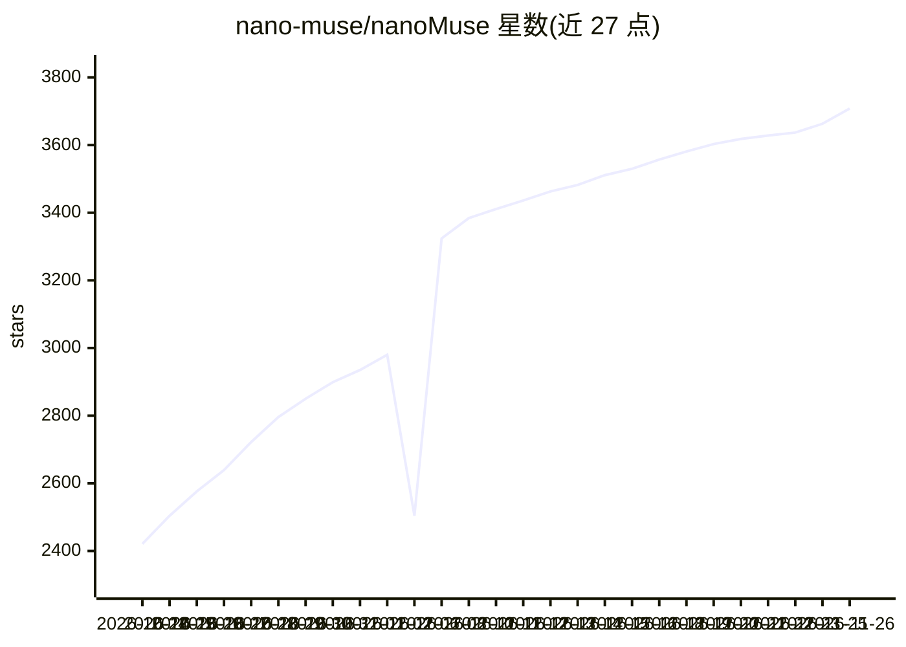

# nano-muse/nanoMuse

⭐ 3,708 · Kotlin · GPL-3.0 · 推送 2026-11-25 · [GitHub](https://github.com/nano-muse/nanoMuse) · [官网](https://nanomuse.cn/) · 个人维护 · 中文 README

**面向个人用户的开源跨设备自主代理：替你操作设备而非只回答**

运行在用户自己的手机、桌面与浏览器上的个人代理，核心能力包括执行任务（Linux shell、浏览器、MCP 服务器与技能、通过截屏操作无 API 的手机/电脑应用）、不可逆操作前先征询确认、跨设备派发任务、定时例程在应用关闭后继续运行、以可编辑的 Markdown 文件存储记忆。各设备各自运行代理实例，经自托管或社区 relay 同步会话；模型接入支持 relay 免费额度、用户自有 key 或已有订阅。提供 Android APK、TestFlight、macOS/Windows/Linux 安装包与 Docker 自托管脚本，GPL-3.0-or-later 许可。

## 筛选速览

| 维度 | 判定 | 备注 |
|---|---|---|
| AI 角色 | `ai-native` | 本体是模型或模型工具 |
| 许可风险 | `viral` | GPL-3.0 |
| 部署形态 | `desktop` | 安装包/桌面程序 |
| 模型依赖 | — | README 未给出锁定关系 |
| 硬件要求 | — | 无带数字的原话,不猜 |
| 安装摩擦 | `low` | 无编译、无系统依赖或容器化 |
| 成熟度 | — | 结构信号不足 |

## 能力要点

- 截屏操作无 API 的手机应用与电脑窗口（iOS 因系统限制除外）
- 删除/发送/支付等不可逆操作前先询问并记住选择
- 跨设备派发任务，会话经 relay 同步，文件与截图留在本地
- 记忆、人格与唤醒规则为可读可编辑的 Markdown 文件

## 适用场景

- 让代理代为操作手机应用和电脑上没有 API 的软件
- 在手机上发起任务、由家中电脑执行并回传确认
- 设定定时目标与晨报例程，应用关闭后仍持续运行
- 用自有 key 或自托管 relay 保持数据不出家门

## 场景标签

`GUI 自动化` `AI 助手` · 领域:效率与自动化

## 证据(README 行号)

> L27: **nanoMuse is an open-source personal agent for every device you own.** One agent with a name and a look of its own
> L67:  Does things. A Linux shell, a browser, MCP servers and skills, and, with Hands on, the apps on your phone and the 
> L77:  Any model. The relay's allowance, your own key at one of twenty-eight providers (Bailian, OpenRouter, OpenAI, Gemi

## 星数曲线

2026-10-24 2,421 → 2026-11-26 3,708（+1,287）

---
*卡片 v1 · prompt 1.4 · 生成 2026-11-23 · 置信度 high · 依据 README sha `5209bee01ac7` · [字段定义](../../DATASET.md)*
