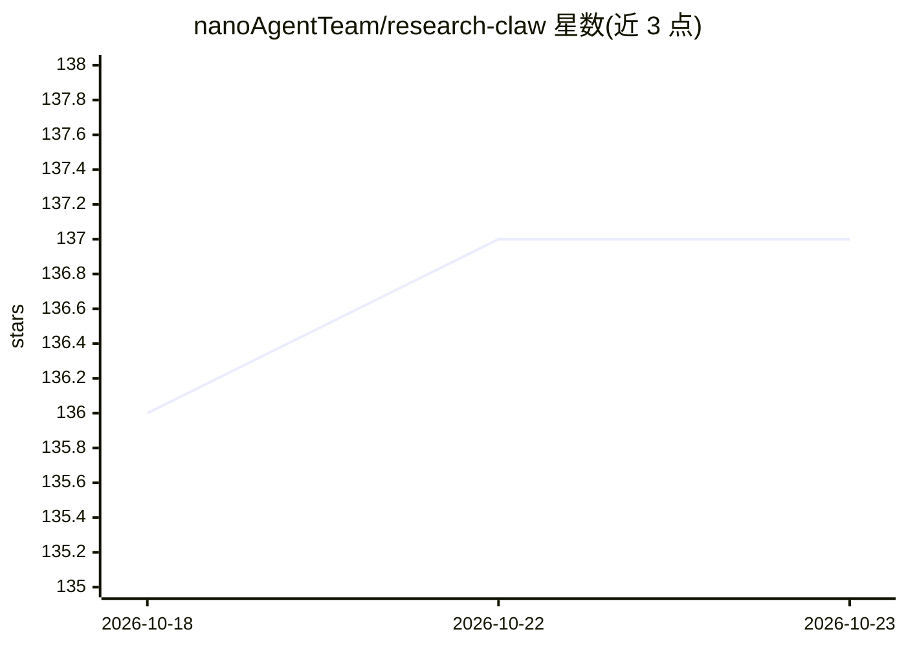

# nanoAgentTeam/research-claw

⭐ 137 · Python · MIT · 推送 2026-06-08 · [GitHub](https://github.com/nanoAgentTeam/research-claw) · 组织维护 · 中文 README

**自托管的科研 AI 助手：管论文、搜文献、追截止期**

面向科研人员的本地部署 AI 助手，通过对话管理 LaTeX 项目、双向同步 Overleaf、检索 arXiv/PubMed/OpenAlex 文献、全文阅读 PDF，并以 cron 定时任务跟踪领域新论文、会议截止期与方向漂移，结果推送到 Telegram/飞书/钉钉等渠道。支持多智能体协作：/task 将目标分解为 DAG 由隔离子代理并行执行；每次 AI 编辑自动提交 Git 可回滚。接入任意 OpenAI 兼容 API 配置模型。Windows 需经 WSL2 运行，不支持原生运行。

## 筛选速览

| 维度 | 判定 | 备注 |
|---|---|---|
| AI 角色 | `ai-native` | 本体是模型或模型工具 |
| 许可风险 | `permissive` | MIT |
| 部署形态 | `library` | 以包/库形式分发 |
| 模型依赖 | — | README 未给出锁定关系 |
| 硬件要求 | — | 无带数字的原话,不猜 |
| 安装摩擦 | `low` | 无编译、无系统依赖或容器化 |
| 成熟度 | — | 结构信号不足 |

## 能力要点

- LaTeX 读写/一键编译与 Overleaf 双向同步
- /task 模式分解目标为 DAG，子代理隔离沙箱并行执行
- 内置文献雷达：每日扫描、截止期跟踪、周报汇总等定时任务
- 多渠道访问：Web UI/CLI/飞书/Telegram/QQ/钉钉

## 适用场景

- 在聊天中管理论文项目并同步 Overleaf
- 自动跟踪领域新论文与会议截止期并推送提醒
- 把复杂写作目标交给多智能体并行完成

## 场景标签

`科研工具` `AI 助手` `多智能体` · 领域:Agent 开发

## 证据(README 行号)

> L3:  Your self-hosted AI research assistant
> L28: Research Claw is a personal AI research assistant you run on your own machine. It manages your LaTeX projects, sync
> L54: - Delegate research, writing, and review to specialized sub-agents

## 星数曲线

2026-10-18 136 → 2026-10-23 137（+1）

---
*卡片 v1 · prompt 1.4 · 生成 2026-10-22 · 置信度 mid · 依据 README sha `9fe8a7ff1f81` · [字段定义](../../DATASET.md)*
