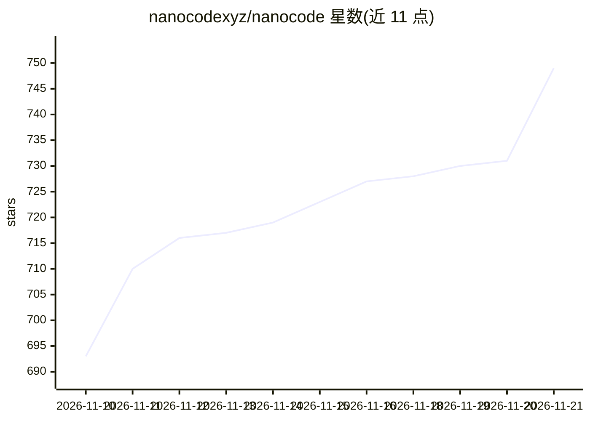

# nanocodexyz/nanocode

⭐ 749 · Rust · Apache-2.0 · 推送 2026-11-20 · [GitHub](https://github.com/nanocodexyz/nanocode) · [官网](https://nanocode.xyz) · 组织维护

**Rust 编写的嵌入式 agent SDK，统一运行 Codex 与 Claude 工具链**

面向嵌入式前沿 agent 的 Rust SDK 与 CLI（nc）：单一运行时承载 Codex 与 Claude 两套 harness（各自的提示词与工具），可运行于终端、服务器、Cloudflare Worker、浏览器标签页或应用。关键机制：模型调用与工具调用均记入日志实现持久化（进程死亡后回合可继续）；Code Mode 由模型编写一个程序调用全部工具、仅结果进入上下文；支持子 agent 派生持久会话；计费可走 ChatGPT/Claude 订阅、API key 或 Tempo Wallet 机器支付。提供 TypeScript(WebAssembly)、Swift、C 绑定。MIT/Apache-2.0 双许可。

## 筛选速览

| 维度 | 判定 | 备注 |
|---|---|---|
| AI 角色 | `ai-ecosystem` | LLM/agent 周边工具 |
| 许可风险 | `permissive` | Apache-2.0 |
| 部署形态 | `None` |  |
| 模型依赖 | locked-api |  |
| 硬件要求 | — | 无带数字的原话,不猜 |
| 安装摩擦 | `low` | 无编译、无系统依赖或容器化 |
| 成熟度 | — | 结构信号不足 |

## 能力要点

- 模型与工具调用全部记日志，进程死亡后回合仍可完成
- Code Mode：模型写一个程序调用所有工具，仅结果进入上下文
- 一个运行时同时承载 Codex 与 Claude 两套 harness
- 多语言绑定：TypeScript(WASM)/Swift/C

## 适用场景

- 在终端或服务器中运行 Codex/Claude 代码 agent
- 把持久化 agent 嵌入 Worker、浏览器标签页或移动应用
- 用订阅而非 API key 为 agent 调用付费

## 场景标签

`Agent 框架` `Agent 记忆` · 领域:Agent 开发

## 证据(README 行号)

> L5: SDK for frontier embedded agents, in Rust. One runtime for the Codex and Claude harnesses, with their own prompts an
> L13: - **Any payer.** A ChatGPT or Claude subscription, an API key, or Machine Payments from a Tempo Wallet.

## 星数曲线

2026-11-10 693 → 2026-11-21 749（+56）

---
*卡片 v1 · prompt 1.4 · 生成 2026-11-17 · 置信度 high · 依据 README sha `f7c64f6387ea` · [字段定义](../../DATASET.md)*
