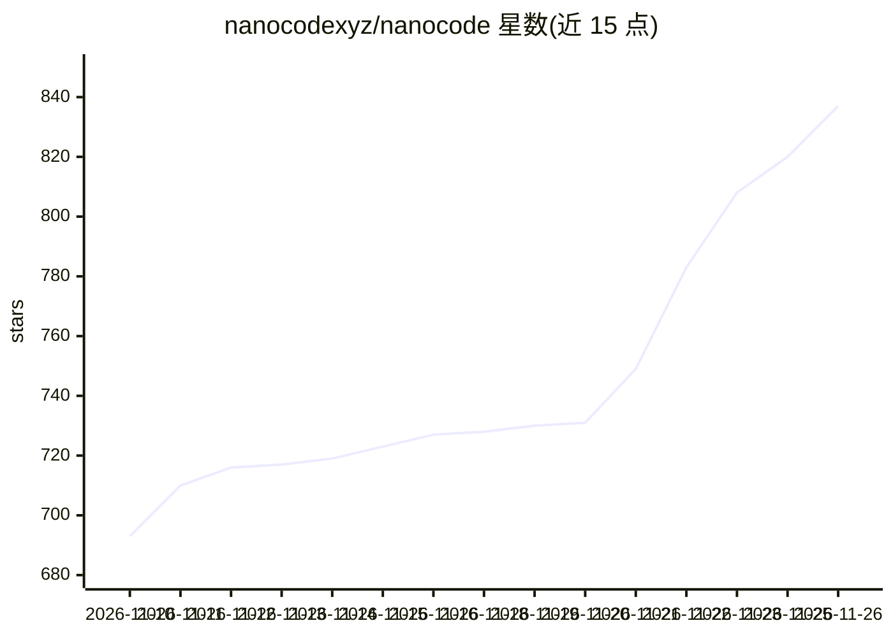

# nanocodexyz/nanocode

⭐ 837 · Rust · Apache-2.0 · 推送 2026-11-25 · [GitHub](https://github.com/nanocodexyz/nanocode) · [官网](https://nanocode.xyz) · 个人维护

**Rust SDK：为嵌入式 agent 提供统一运行时**

以 Rust 编写的 agent SDK 与 CLI，将 Codex 和 Claude 两类 harness 统一到同一运行时，各保留其自带的提示词与工具；可在终端、服务器、Worker、浏览器标签页或应用中运行。机制包括：每次模型与工具调用写入日志以实现进程终止后回合可续（durable）、Code Mode 让模型生成单一程序调用全部工具且仅结果进入上下文、子 agent 生成独立的 durable 会话。支付方式支持 ChatGPT/Claude 订阅、API key 或 Tempo 账户。

## 筛选速览

| 维度 | 判定 | 备注 |
|---|---|---|
| AI 角色 | `ai-ecosystem` | LLM/agent 周边工具 |
| 许可风险 | `permissive` | Apache-2.0 |
| 部署形态 | `None` |  |
| 模型依赖 | — | README 未给出锁定关系 |
| 硬件要求 | — | 无带数字的原话,不猜 |
| 安装摩擦 | `low` | 无编译、无系统依赖或容器化 |
| 成熟度 | — | 结构信号不足 |

## 能力要点

- 每次模型与工具调用记录日志，进程死亡后回合可完成（durable）
- Code Mode：模型写一个程序调用全部工具，仅结果进入上下文
- 同一 SDK 提供 TypeScript/WebAssembly、Swift、C 多语言版本
- 支付方式支持订阅、API key 或 Tempo 账户

## 适用场景

- 在终端或服务器中通过 nc CLI 与代码库进行问答
- 将 agent 运行时嵌入浏览器标签页或应用中
- 为需要进程中断恢复的长回合 agent 场景提供运行时

## 场景标签

`Agent 框架` · 领域:Agent 开发

## 证据(README 行号)

> L5: SDK for frontier embedded agents, in Rust. One runtime for the Codex and Claude harnesses, with their own prompts an
> L9: - **Durable.** Every model call and tool call is journaled, so a turn finishes after its process dies.

## 星数曲线

2026-11-10 693 → 2026-11-26 837（+144）

---
*卡片 v1 · prompt 1.4 · 生成 2026-11-24 · 置信度 high · 依据 README sha `523a651a6663` · [字段定义](../../DATASET.md)*
