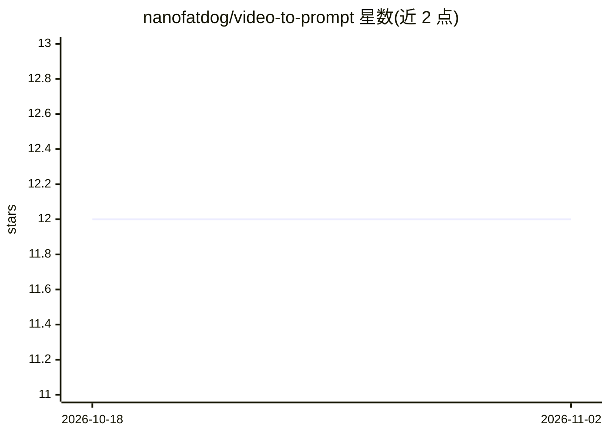

# nanofatdog/video-to-prompt

⭐ 12 · Python · NOASSERTION · 推送 2026-05-26 · [GitHub](https://github.com/nanofatdog/video-to-prompt) · 个人维护

**从视频抽取帧并生成 AI 绘图提示词的 WebUI/CLI 工具**

Gradio Web 应用 + CLI：从上传视频中抽帧，发送到 llama.cpp 视觉模型 API（OpenAI 兼容接口），生成描述、标签、摘要、Danbooru 标签或 NSFW 评级 5 种模式的提示词，支持自定义 prompt、帧数/温度等参数调节、帧预览与 ZIP 导出。另提供 FastAPI REST 服务供 AI agent 程序化调用。面向使用 Stable Diffusion / Midjourney 等绘图工具的提示词工程师与内容分析用户。需自备 llama.cpp 视觉模型服务端，系统依赖 Python 3.10+、FFmpeg、Git。

## 筛选速览

| 维度 | 判定 | 备注 |
|---|---|---|
| AI 角色 | `ai-native` | 本体是模型或模型工具 |
| 许可风险 | `none` | NOASSERTION |
| 部署形态 | `None` |  |
| 模型依赖 | local-ok | 支持本地模型 |
| 硬件要求 | — | 无带数字的原话,不猜 |
| 安装摩擦 | `medium` | 含编译或系统依赖之一 |
| 成熟度 | — | 结构信号不足 |

## 能力要点

- 5 种提示词模式（Describe/Summarize/Tags/Danbooru/NSFW Check）+ 自定义 prompt
- 连接任意 llama.cpp 视觉端点，OpenAI 兼容消息格式，支持 Bearer 认证
- 提供 CLI 与 FastAPI REST 服务（Swagger 文档），可供 AI agent 调用
- 一键 curl|bash 安装、帧时间戳预览、结果历史与 ZIP 帧导出

## 适用场景

- 从视频生成 Stable Diffusion / Midjourney 的绘图提示词
- 为动漫/美术数据集批量生成 Danbooru 风格标签
- 对视频做 NSFW 内容评级与内容编目
- 通过 REST API 将视频分析嵌入 AI agent 工作流

## 场景标签

`提示工程` `多模态` · 领域:Agent 开发

## 证据(README 行号)

> L3: > Extract AI image generation prompts from video using Vision Language Model (llama.cpp API)
> L12: - 🧠 **5 prompt modes** — Describe, Summarize, Tags, Danbooru, NSFW Check
> L77: python3 video_to_prompt.py video.mp4

## 星数曲线

2026-10-18 12 → 2026-11-02 12（+0）

---
*卡片 v1 · prompt 1.4 · 生成 2026-11-01 · 置信度 high · 依据 README sha `ca198f0f1e22` · [字段定义](../../DATASET.md)*
