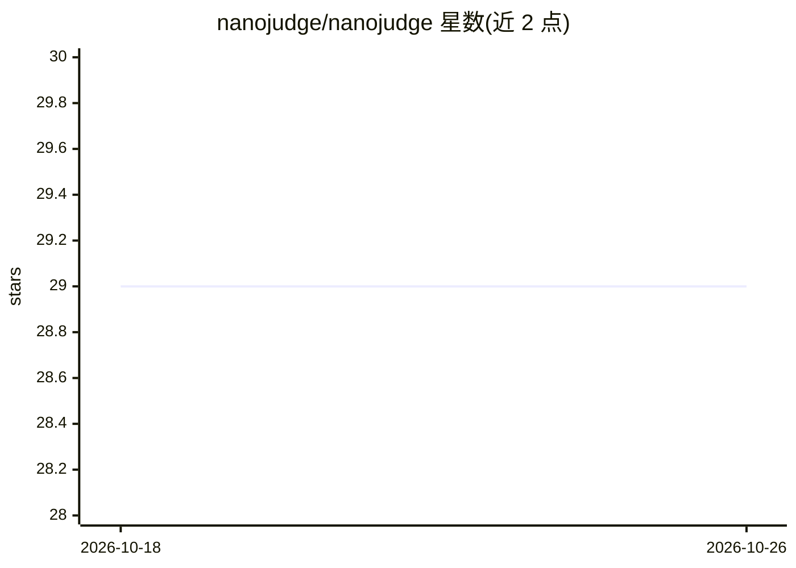

# nanojudge/nanojudge

⭐ 29 · Rust · MIT · 推送 2026-10-19 · [GitHub](https://github.com/nanojudge/nanojudge) · [官网](https://nanojudge.ai/) · 组织维护

**用 LLM 裁判对任意列表按自定义标准排序的排行引擎**

Rust 实现的排序引擎：用户给出评价标准（如“哪个更健康”）和任意长度的条目列表，系统将其拆解为大量两两对决的小型 LLM 提示，自适应选择最能提升信息量的对比，用 Bradley-Terry 统计合成带置信区间的排名，并自动测量与修正位置偏差。兼容任意 OpenAI 兼容 API 端点，支持多裁判面板、logprobs 置信读取、判断结果保存与复用、JSON 输出。提供 CLI 与可作 Rust 依赖的纯计算核心 crate，附带托管版 nanojudge.ai。

## 筛选速览

| 维度 | 判定 | 备注 |
|---|---|---|
| AI 角色 | `ai-ecosystem` | LLM/agent 周边工具 |
| 许可风险 | `permissive` | MIT |
| 部署形态 | `library` | 以包/库形式分发 |
| 模型依赖 | — | README 未给出锁定关系 |
| 硬件要求 | — | 无带数字的原话,不猜 |
| 安装摩擦 | `low` | 无编译、无系统依赖或容器化 |
| 成熟度 | — | 结构信号不足 |

## 能力要点

- LLM 两两对决 + Bradley-Terry 统计合成带 95% 置信区间的排名
- 自适应选择对比（top-heavy/uniform 分布），可扩至数十万条目
- 多裁判面板与 OpenAI 兼容端点支持，可用 logprobs 读取裁决置信度
- 判断结果 JSONL 保存/加载，重打分无需再调用端点

## 适用场景

- 按主观标准给长列表排序并得到量化排名
- 为 agent 系统提供大候选集的排序构件
- 复用已保存的判断结果增量继续排行

## 场景标签

`模型评测` · 领域:评测与运维

## 证据(README 行号)

> L3: NanoJudge quantifies the relative strengths of arbitrary items under a criterion you define, using LLMs as judges. P
> L5: Instead of overwhelming an LLM with one massive prompt, NanoJudge breaks the task down into a large number of small 
> L130: Instead, the main LLM can act as the orchestrator: it fetches the candidates, passes the list and the subjective c

## 星数曲线

2026-10-18 29 → 2026-10-26 29（+0）

---
*卡片 v1 · prompt 1.4 · 生成 2026-10-26 · 置信度 high · 依据 README sha `f300b706cadc` · [字段定义](../../DATASET.md)*
