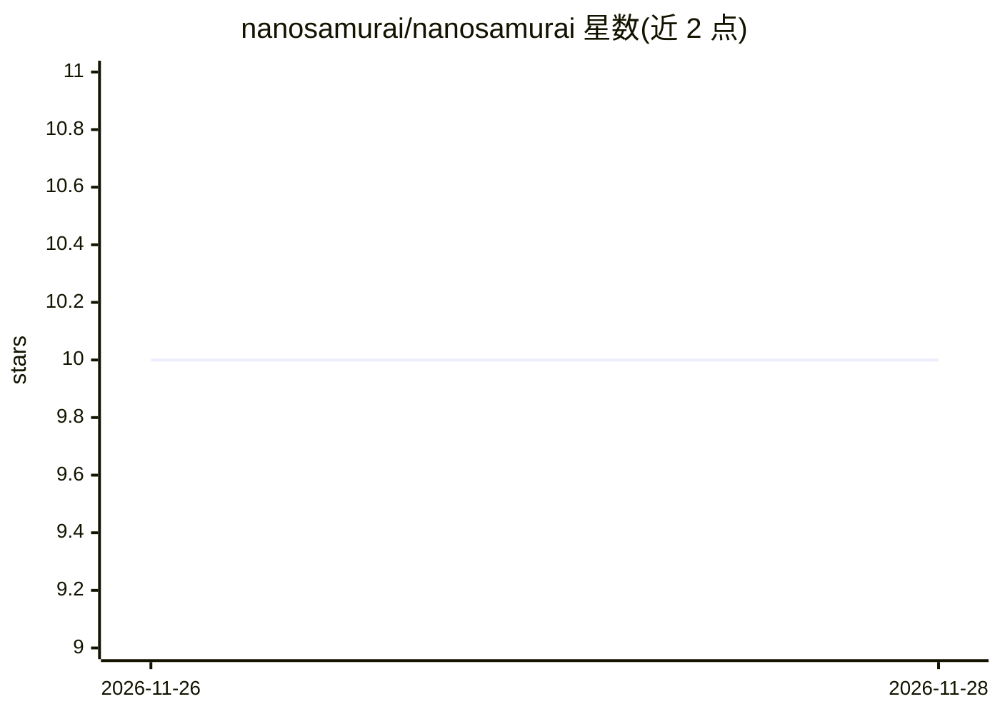

# nanosamurai/nanosamurai

⭐ 10 · Python · Apache-2.0 · 推送 2026-11-26 · [GitHub](https://github.com/nanosamurai/nanosamurai) · [官网](https://nanosamur.ai) · 组织维护

**自托管语音转写平台：敏感对话不出本地基础设施**

面向不能把敏感对话交给第三方的组织，提供可自托管的语音转写平台：以 Docker Compose 运行分布式服务栈，支持实时与批量转写、说话人分离标签、录音存储、转写修正与团队共享、登录与多租户。模型不可绑定，默认使用 NVIDIA Nemotron 与 Parakeet，可经 overlay 添加 Whisper、Voxtral、Qwen ASR。工作流对已完成的转写执行用户提示词，默认调用本机 Ollama。要求 NVIDIA GPU；代码为 Apache-2.0，各模型另有自身许可。

## 筛选速览

| 维度 | 判定 | 备注 |
|---|---|---|
| AI 角色 | `ai-native` | 本体是模型或模型工具 |
| 许可风险 | `permissive` | Apache-2.0 |
| 部署形态 | `self-host` | docker 或自建部署 |
| 模型依赖 | local-ok | 支持本地模型 |
| 硬件要求 | — | 无带数字的原话,不猜 |
| 安装摩擦 | `low` | 无编译、无系统依赖或容器化 |
| 成熟度 | — | 结构信号不足 |

## 能力要点

- 实时/精修/最终三段转写，可多模型并行对比同一音频
- 说话人标签（Sortformer/pyannote）与录音会话存储
- 多租户、登录、角色、共享与转写修正
- Grafana/Prometheus/Loki/Tempo 可选可观测性栈

## 适用场景

- 组织内部会议录音转写且数据不出内网
- 团队共享、修正并检索转写记录
- 在同一音频上对比多个开源 ASR 模型的效果
- 用本地 LLM 对转写结果做摘要与行动项提取

## 场景标签

`语音识别` `AI 写作` · 领域:内容生成

## 证据(README 行号)

> L8: nanosamur.ai guards sensitive conversations in infrastructure you control. It
> L9: is a self-hosted transcription platform for open speech models.
> L13: - live and batch transcription (incl. recording storage)

## 星数曲线

2026-11-26 10 → 2026-11-28 10（+0）

---
*卡片 v1 · prompt 1.4 · 生成 2026-11-27 · 置信度 high · 依据 README sha `e6b3f866b5f6` · [字段定义](../../DATASET.md)*
