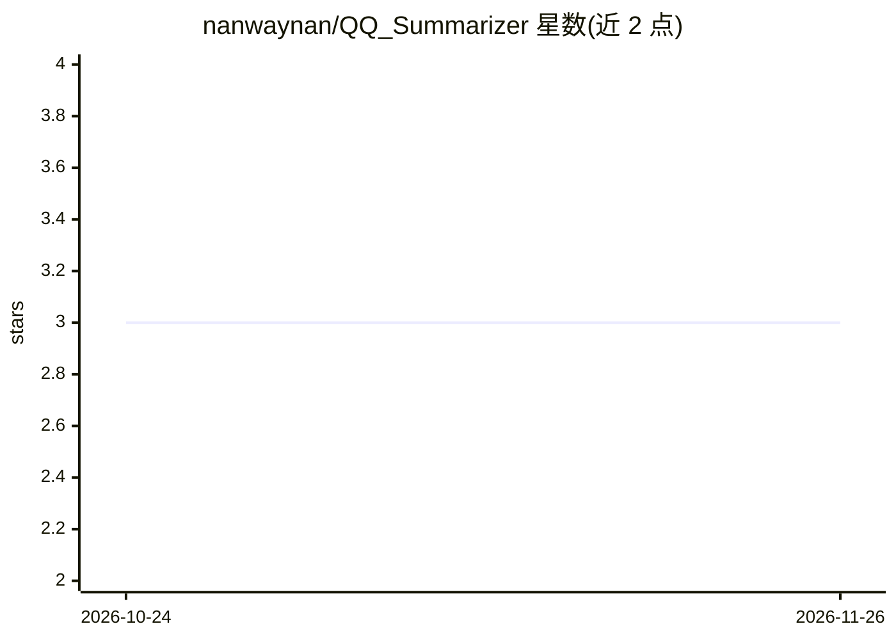

# nanwaynan/QQ_Summarizer

⭐ 3 · Python · MIT · 推送 2026-11-09 · [GitHub](https://github.com/nanwaynan/QQ_Summarizer) · 个人维护 · 中文 README

**QQ 群聊记录 AI 总结与归档的 Windows 桌面工具**

通过 NapCat（OneBot 11 协议）读取本机已登录 QQ 的群消息，交由用户自配的 OpenAI 兼容接口生成结构化日报（概览/话题/干货/精彩发言），并按评分用视觉模型甄选图片配说明，按日期归档为本地 Markdown。提供 PySide6 桌面界面与 CLI，支持每日定时任务、错过补跑、开机自启、智能分块处理长记录。明确不向群发消息、聊天记录不传第三方，依赖 NapCat 内存注入 QQ，需指定 QQ 版本且启动需管理员权限。

## 筛选速览

| 维度 | 判定 | 备注 |
|---|---|---|
| AI 角色 | `ai-native` | 本体是模型或模型工具 |
| 许可风险 | `permissive` | MIT |
| 部署形态 | `desktop` | 安装包/桌面程序 |
| 模型依赖 | local-ok | 支持本地模型 |
| 硬件要求 | — | 无带数字的原话,不猜 |
| 安装摩擦 | `medium` | 含编译或系统依赖之一 |
| 成熟度 | — | 结构信号不足 |

## 能力要点

- 从本机 QQ 拉取指定时间段群消息，生成结构化 Markdown 日报
- AI 图片甄选：视觉模型评分并配文字说明，可设每期上限与最低分
- 智能分块：记录超 2.2 万字自动分块总结再汇总
- 每日定时任务、错过补跑、开机静默托盘自启

## 适用场景

- 每天自动把活跃 QQ 群的聊天整理成可长期检索的存档
- 一天没看群后快速了解群里的话题和有价值信息
- 保留群里的报错截图、教程步骤等图片并附说明

## 场景标签

`AI 写作` `文档解析` · 领域:内容生成

## 证据(README 行号)

> L3: 拉取 QQ 群聊天记录 → 大模型总结 + 图片甄选 → 归档为 Markdown 的 Windows 桌面程序。
> L77: 你的 QQ  ←─(NapCat 读取)─→  本程序  ←─(API 调用)─→  AI 大模型
> L547: |**AI 接口**|任意 OpenAI 兼容接口|要图片甄选，模型需支持视觉输入|

## 星数曲线

2026-10-24 3 → 2026-11-26 3（+0）

---
*卡片 v1 · prompt 1.4 · 生成 2026-11-21 · 置信度 high · 依据 README sha `f7b437fe99bc` · [字段定义](../../DATASET.md)*
