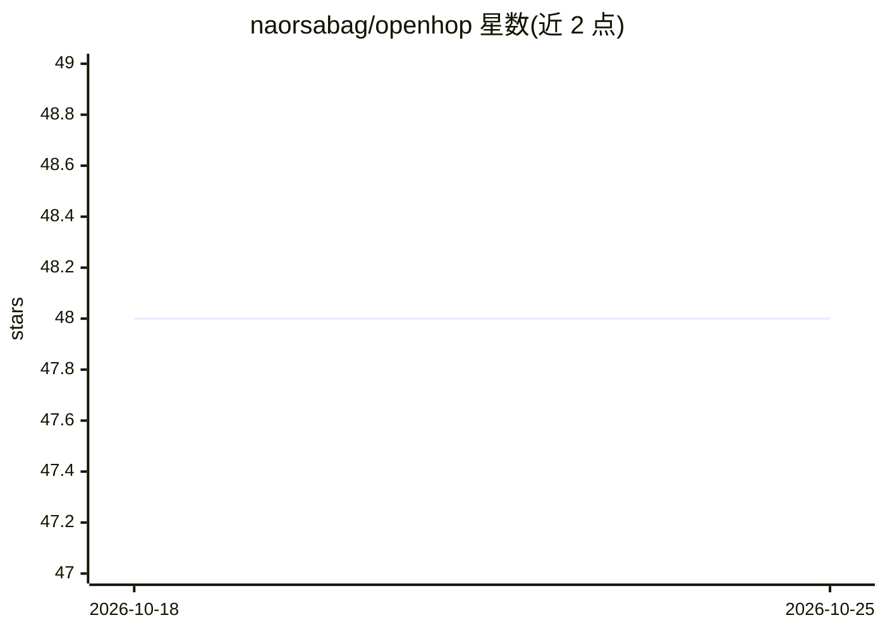

# naorsabag/openhop

⭐ 48 · TypeScript · MIT · 推送 2026-10-21 · [GitHub](https://github.com/naorsabag/openhop) · [官网](https://naorsabag.github.io/openhop/) · 个人维护

**让 AI agent 生成交互式数据流图的技能与本地渲染工具**

面向 Claude Code、Cursor、Codex 等 AI 编程客户端的可安装技能（SKILL.md）：agent 识别“讲解/追踪/图解代码流程”类指令后，改用紧凑 YAML 描述数据流（约每步 100 token），由同一 npm 包内的 CLI 与本地服务器渲染为可播放、暂停、逐跳步进的交互式图表。本地优先、无遥测、无托管后端；分享通过把 YAML 压缩进 URL hash 完成。安装仅一步（npx openhop init 或 openskills），另提供插件与源码路径。

## 筛选速览

| 维度 | 判定 | 备注 |
|---|---|---|
| AI 角色 | `ai-ecosystem` | LLM/agent 周边工具 |
| 许可风险 | `permissive` | MIT |
| 部署形态 | `library` | 以包/库形式分发 |
| 模型依赖 | — | README 未给出锁定关系 |
| 硬件要求 | — | 无带数字的原话,不猜 |
| 安装摩擦 | `low` | 无编译、无系统依赖或容器化 |
| 成熟度 | — | 结构信号不足 |

## 能力要点

- SKILL.md 技能安装后 agent 将流程讲解转为 YAML + 交互图
- 紧凑 YAML 格式，约每步 100 token，无 MCP 常驻
- 本地优先：代码不离机、无遥测、无账号
- 流程分享压缩进 URL hash，无需上传

## 适用场景

- 让 agent 逐步讲解代码库中的认证/请求/状态流转
- 把 OAuth、订单管道等流程做成可步进的交互图
- 替代长篇 Markdown 讲解做代码评审沟通

## 场景标签

 · 领域:开发者工具/代码可视化

## 证据(README 行号)

> L84: OpenHop is a skill — a `SKILL.md` file your AI agent reads to learn how to render flows. **Installing the skill is 
> L143: The skill activates on prompts asking your agent to **explain, walk through, trace, visualize, or diagram** how da

## 星数曲线

2026-10-18 48 → 2026-10-25 48（+0）

---
*卡片 v1 · prompt 1.4 · 生成 2026-10-25 · 置信度 high · 依据 README sha `2b477276cdfb` · [字段定义](../../DATASET.md)*
