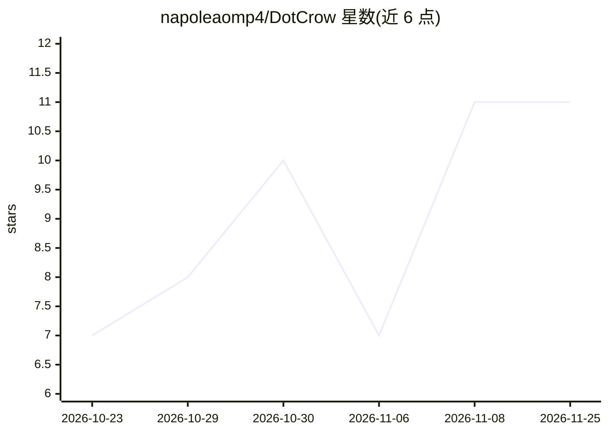

# napoleaomp4/DotCrow

⭐ 11 · Rust · Apache-2.0 · 推送 2026-11-16 · [GitHub](https://github.com/napoleaomp4/DotCrow) · 个人维护

**本地运行的多 agent AI 任务执行工具：委派整任务由六个 agent 协作完成**

用 Rust 编写的桌面/终端多 agent 系统：用户交给一个完整任务，由六只'乌鸦'角色（规划、记忆、组织、执行、写作、风控）协作完成，最多 200 步/任务；Oracle 模型按请求复杂度分派 agent 数量，cheap 模型干活。支持 Chrome 扩展操控浏览器、Android 手机操作、语音输入转录、257 个官方 API 连接器、后量子加密（ML-KEM-768 + X25519）、API key 保险库与不可逆操作确认。提供 Windows/Linux 安装包、脚本安装和手动编译路径，也支持在 Termux 运行。声明为 pre-alpha，尚未外部审计。

## 筛选速览

| 维度 | 判定 | 备注 |
|---|---|---|
| AI 角色 | `ai-native` | 本体是模型或模型工具 |
| 许可风险 | `permissive` | Apache-2.0 |
| 部署形态 | `desktop` | 安装包/桌面程序 |
| 模型依赖 | local-ok | 支持本地模型 |
| 硬件要求 | — | 无带数字的原话,不猜 |
| 安装摩擦 | `high` | 编译与系统依赖俱全 |
| 成熟度 | `idea` | |

## 能力要点

- 六角色 agent 协作：规划→执行→检查→报告，任务内互相审阅
- Oracle（Opus）按请求复杂度决定 1 个或全部 6 个 agent，cheap 模型（claude-haiku / gpt-nano）执行
- 通过 Chrome 扩展在用户自己的浏览器和账号中操作，敏感动作需确认
- 端到端加密手机隧道、Android 屏幕操控、语音输入转录

## 适用场景

- 把'整理下载目录并汇总'这类完整任务交给 agent 代办
- 在终端中对项目文件夹下发文件编辑类指令
- 通过手机远程查看和控制家中电脑上的 agent 任务
- 录制重复性操作作为可复用 recipe

## 场景标签

`多智能体` `浏览器自动化` `GUI 自动化` · 领域:Agent 开发

## 证据(README 行号)

> L31: Em vez de pedir uma resposta a um chat, você entrega ao **DotCrow** uma tarefa inteira —
> L35: — e um bando de agentes resolve: um planeja, um lembra como já foi feito antes, um confere os riscos, um executa e 
> L42: - 🔮 **O Oráculo decide quantos corvos trabalham.** Ele roda no Opus 5.5 e lê cada pedido antes do bando: um *"Oi"* 

## 星数曲线

2026-10-23 7 → 2026-11-25 11（+4）

---
*卡片 v1 · prompt 1.4 · 生成 2026-11-18 · 置信度 high · 依据 README sha `f2cd0e5d6fd5` · [字段定义](../../DATASET.md)*
