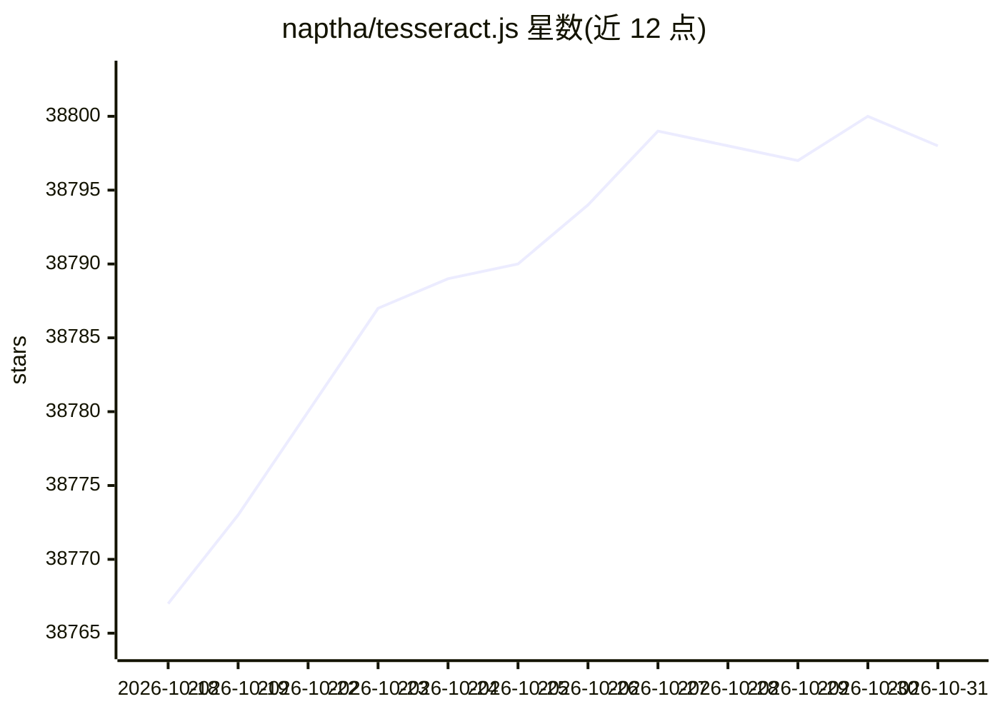

# naptha/tesseract.js

⭐ 38,798 · JavaScript · Apache-2.0 · 推送 2026-05-17 · [GitHub](https://github.com/naptha/tesseract.js) · [官网](http://tesseract.projectnaptha.com/) · 个人维护

**JS 库：浏览器/Node 从图片识别 100+ 语言文字**

Tesseract.js 是 JavaScript OCR 库，通过封装 Tesseract 的 WebAssembly 移植版，在浏览器（webpack/ESM/script 标签+CDN）和 Node.js 中从图片提取文字。支持图片识别与视频实时识别示例，v4 起提供旋转预处理与并行处理（schedulers）。项目范围明确：不修改 Tesseract 核心识别模型、不支持 PDF；需 PDF 提取或精度改进的项目被指引至 Scribe.js。npm/yarn 或 CDN 安装，v7 需 Node.js v16+。

## 筛选速览

| 维度 | 判定 | 备注 |
|---|---|---|
| AI 角色 | `ai-ecosystem` | LLM/agent 周边工具 |
| 许可风险 | `permissive` | Apache-2.0 |
| 部署形态 | `library` | 以包/库形式分发 |
| 模型依赖 | — | README 未给出锁定关系 |
| 硬件要求 | — | 无带数字的原话,不猜 |
| 安装摩擦 | `low` | 无编译、无系统依赖或容器化 |
| 成熟度 | — | 结构信号不足 |

## 动量与使用信号

- 维护:`maintenance` — 距上次 push 154.1 天,年发版 1,79 位贡献者
- 涨星:近 1 天 **+0**(自 20261016 起算)
- 安装:npm 包 `tesseract.js` 月下载 13,832,439

## 能力要点

- 支持 100+ 语言图片文字识别
- 浏览器与 Node.js 双端运行（WebAssembly 封装）
- 旋转/灰度/二值化预处理选项与并行调度器
- 多图识别的 worker 复用模式

## 适用场景

- 网页中上传图片并提取其中文字
- Node 服务端批量识别多语言图片文本
- 文档扫描类 Web 应用的 OCR 底层

## 场景标签

`OCR` · 领域:感知与多模态

## 证据(README 行号)

> L17: Tesseract.js is a javascript library that gets words in almost any language out of images. (Demo)
> L27: Tesseract.js works in the browser using webpack, esm, or plain script tags with a CDN and on the server with Node.j
> L62: Tesseract.js aims to bring the Tesseract OCR engine (a separate project) to the browser and Node.js, and works by w

## 星数曲线

2026-10-18 38,767 → 2026-10-31 38,798（+31）

---
*卡片 v1 · prompt 1.4 · 生成 2026-10-18 · 置信度 high · 依据 README sha `5a3f5e80b30e` · [字段定义](../../DATASET.md)*
