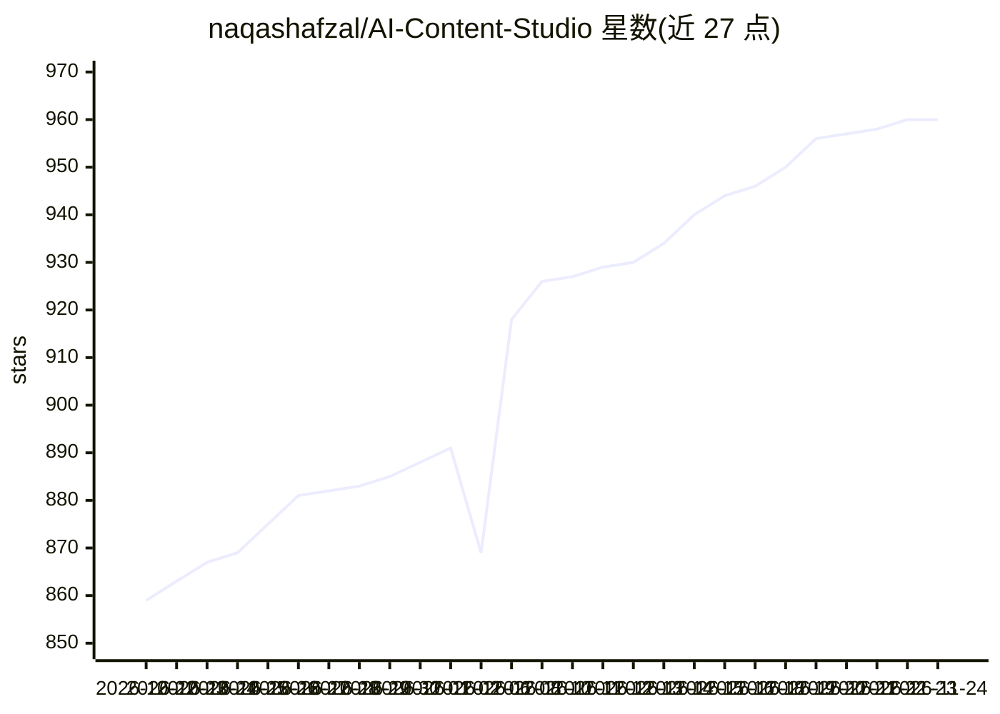

# naqashafzal/AI-Content-Studio

⭐ 964 · Python · NOASSERTION · 推送 2026-10-30 · [GitHub](https://github.com/naqashafzal/AI-Content-Studio) · [官网](http://ai.nullpk.com) · 个人维护

**AI 视频内容自动化工具：自动写脚本、配音、生成并上传视频**

面向 YouTube/短视频创作者的内容生产系统：多 agent 流水线覆盖选题研究、脚本撰写、QA 重写、配音 TTS、剪辑渲染与字幕烧录，并支持从长视频切出竖版短片。内置 SQLite 任务队列支持断点恢复，多模型网关连接 Gemini、OpenAI 兼容端点与本地 Ollama，支持乌尔都语语音校正。部署需 Python 3.12、Node.js 22+、FFmpeg 与 Gemini API key，MIT 许可。

## 筛选速览

| 维度 | 判定 | 备注 |
|---|---|---|
| AI 角色 | `ai-native` | 本体是模型或模型工具 |
| 许可风险 | `none` | NOASSERTION |
| 部署形态 | `None` |  |
| 模型依赖 | local-ok | 支持本地模型 |
| 硬件要求 | — | 无带数字的原话,不猜 |
| 安装摩擦 | `medium` | 含编译或系统依赖之一 |
| 成熟度 | — | 结构信号不足 |

## 能力要点

- 多 agent 监督编排：研究、脚本、QA 评分低于 80 自动重写
- Magic Clipper 融合 Whisper 转写、音量峰值与 OpenCV 直方图切镜定位高光片段
- 多模型网关：Gemini、OpenAI 兼容端点、本地 Ollama，自动故障切换
- 文本式波纹剪辑：删除转写文字即自动剪切对应视频音频

## 适用场景

- 批量自动化产出 YouTube 短视频并定时发布
- 把长视频/播客切成分发到 TikTok/Reels 的竖版短片
- 生成乌尔都语/罗马乌尔都语配音的教育解说视频

## 场景标签

`多智能体` `语音合成` `模型网关` `视频生成` · 领域:Agent 开发

## 证据(README 行号)

> L11: **AI Content Studio Next-Gen (v2.0)** transforms video generation from a rigid script-to-video pipeline into an aut
> L45: - **Multi-Model Router:** Unified provider gateway supporting Google Gemini, OpenAI-compatible endpoints, and local
> L76: - **Server:** FastAPI (Python 3.12) & Uvicorn

## 星数曲线

2026-10-22 859 → 2026-11-24 960（+101）

---
*卡片 v1 · prompt 1.4 · 生成 2026-11-24 · 置信度 high · 依据 README sha `6f5b657658e6` · [字段定义](../../DATASET.md)*
