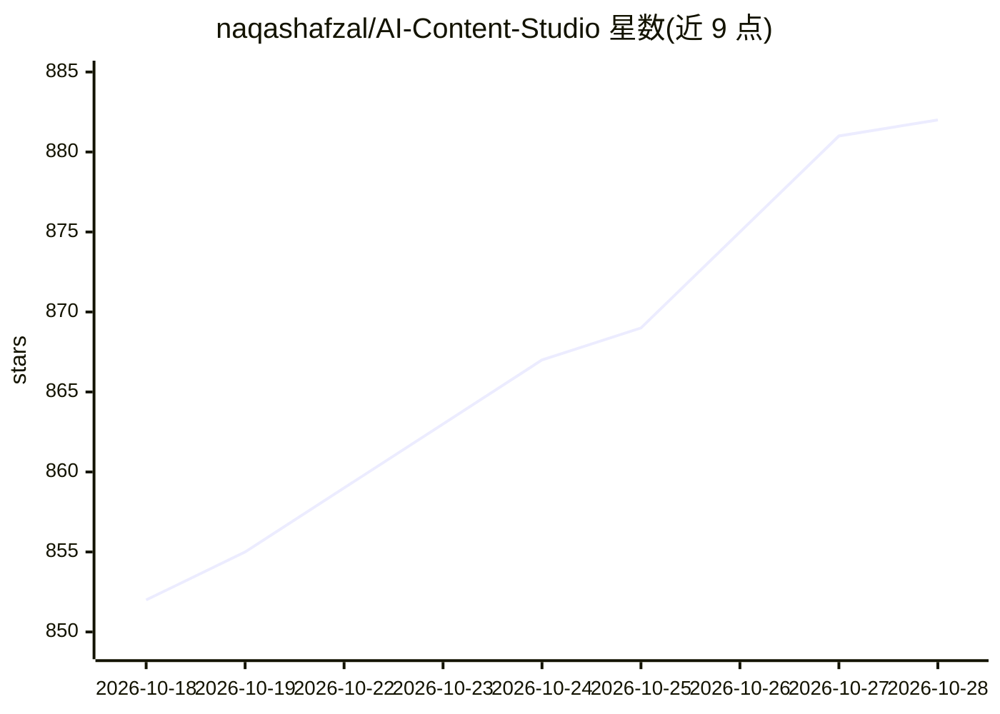

# naqashafzal/AI-Content-Studio

⭐ 882 · Python · NOASSERTION · 推送 2026-10-25 · [GitHub](https://github.com/naqashafzal/AI-Content-Studio) · [官网](http://ai.nullpk.com) · 个人维护

**自主 AI 内容创作平台：自动写脚本、配音、剪辑视频并发布**

面向内容创作者的 Web 应用，以多 Agent 监督架构（策略/研究/编剧/质检等 Agent）自动完成从选题研究、脚本撰写、QA 自愈改写到语音合成、视频渲染的流程；支持 Google Gemini、OpenAI 兼容 API 与本地 Ollama 多模型网关及自动故障转移。附带长视频切片为竖版短视频、参考视频风格克隆、转录涟漪编辑器、SQLite 断点恢复队列与自动发布。需 Python 3.10+、Node.js 18+ 与 FFmpeg，源码运行，含 Whisper 离线转录与乌尔都语语音支持。

## 筛选速览

| 维度 | 判定 | 备注 |
|---|---|---|
| AI 角色 | `ai-native` | 本体是模型或模型工具 |
| 许可风险 | `none` | NOASSERTION |
| 部署形态 | `library` | 以包/库形式分发 |
| 模型依赖 | local-ok | 支持本地模型 |
| 硬件要求 | — | 无带数字的原话,不猜 |
| 安装摩擦 | `medium` | 含编译或系统依赖之一 |
| 成熟度 | — | 结构信号不足 |

## 能力要点

- 多 Agent 监督团队执行研究、编剧、QA 与持久记忆，QA 低于 80 分自动重写
- 多模态热点融合切片：Whisper 转录 + 音频峰值 + OpenCV 场景切分生成竖版短视频
- 多模型网关支持 Gemini、OpenAI 兼容端点与本地 Ollama，含自动故障转移
- SQLite 任务队列带阶段检查点，重启后自动恢复中断任务

## 适用场景

- 全自动批量生产 YouTube/短视频频道内容
- 把长视频或播客切成 TikTok/Shorts/Reels 竖版短片
- 自动排期 24/7 扫描热点并生成发布内容

## 场景标签

`多智能体` `语音合成` `AI 写作` `视频生成` · 领域:Agent 开发

## 证据(README 行号)

> L10: **AI Content Studio Next-Gen (v2.0)** transforms video generation from a rigid script-to-video pipeline into an aut
> L44: - **Multi-Model Router:** Unified provider gateway supporting Google Gemini, OpenAI-compatible endpoints, and local
> L48: - **Automated Campaigns:** Schedule 24/7 background bots to scan trending topics and generate content on automated 

## 星数曲线

2026-10-18 852 → 2026-10-28 882（+30）

---
*卡片 v1 · prompt 1.4 · 生成 2026-10-21 · 置信度 high · 依据 README sha `c6ec5d1e8d00` · [字段定义](../../DATASET.md)*
