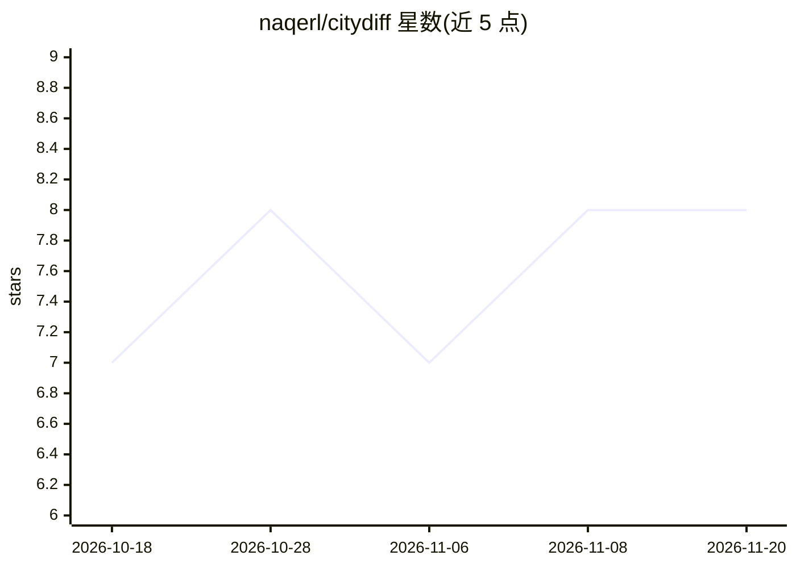

# naqerl/citydiff

⭐ 8 · JavaScript · Apache-2.0 · 推送 2026-10-21 · [GitHub](https://github.com/naqerl/citydiff) · 个人维护

**把代码差异渲染为 3D 城市并为变更生成导览的 diff 工具**

以 3D 城市隐喻呈现代码结构：包为建筑、类型为宽块、函数/方法为高度等于函数体大小的塔，调用关系为弧线。工具读取 commit 范围生成可交互导览，支持搜索声明后按 D 查看真实 unified diff、按 E 在城市视图上用 nvim 打开对应行，按 y 查看包级依赖鸟瞰图，/skin 切换主题。提供在线站点直接试用，也可通过脚本由 agent 安装，Apache-2.0 许可。

## 筛选速览

| 维度 | 判定 | 备注 |
|---|---|---|
| AI 角色 | `ai-enhanced` | 去掉 AI 部分产品仍成立 |
| 许可风险 | `permissive` | Apache-2.0 |
| 部署形态 | `None` |  |
| 模型依赖 | — | README 未给出锁定关系 |
| 硬件要求 | — | 无带数字的原话,不猜 |
| 安装摩擦 | `low` | 无编译、无系统依赖或容器化 |
| 成熟度 | — | 结构信号不足 |

## 能力要点

- 将包/类型/函数映射为城市建筑、塔楼与调用弧线
- 搜索声明后可查看真实 git diff 并从城市视图启动 nvim
- 按包与依赖弧线的鸟瞰图浏览架构
- 提供无需安装的在线站点与 /skin 主题切换

## 适用场景

- 审查代码变更时按架构视角浏览 diff
- 以城市地图形式检查代码库的包结构与依赖
- 为当前项目生成变更导览向他人演示

## 场景标签

 · 领域:开发者工具/代码可视化

## 证据(README 行号)

> L5: **Higher order** diff tool that helps humans to control architecture and agents to generate interactive tours over t
> L30: the real git diff and nvim over the city

## 星数曲线

2026-10-18 7 → 2026-11-20 8（+1）

---
*卡片 v1 · prompt 1.4 · 生成 2026-11-20 · 置信度 mid · 依据 README sha `7b7e10e311a5` · [字段定义](../../DATASET.md)*
