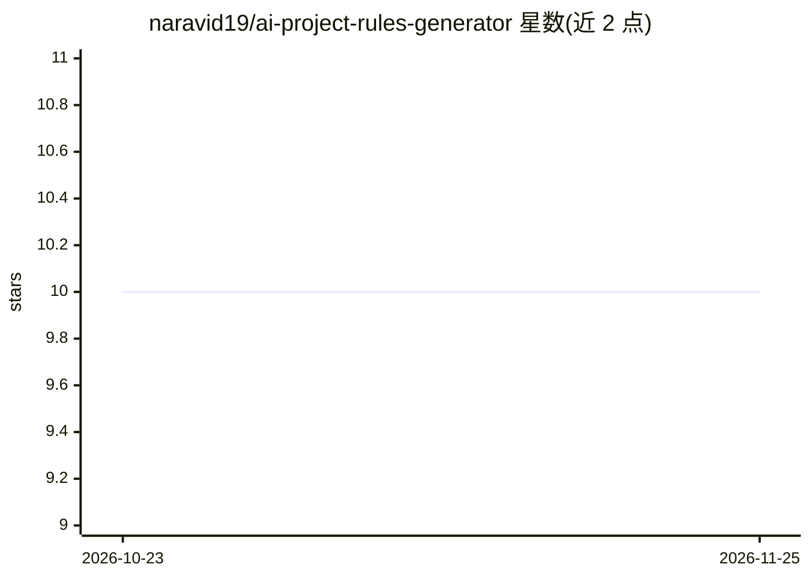

# naravid19/ai-project-rules-generator

⭐ 10 · Python · MIT · 推送 2026-06-01 · [GitHub](https://github.com/naravid19/ai-project-rules-generator) · 个人维护

**为 AI 编码助手生成项目规则文件与 AGENTS.md 的 Agent 技能**

以 Agent Skill 形式提供的规则生成器：用户让编码代理（Claude Code/Gemini CLI/Codex CLI）生成项目规则时，通过确定性 JIT 检索在本地、全局与远程三处环境索引可用技能，用语义回退与模糊匹配选出最相关的 5 个技能，编译为 .cursorrules 或 AGENTS.md。目标是在不占满 LLM 上下文窗口的前提下给代理提供约束与架构模式。支持 .rulesrc.yaml 配置技能源，远程源超时回退本地 .cache 缓存；遵循 TDD，附 pytest 测试套件。

## 筛选速览

| 维度 | 判定 | 备注 |
|---|---|---|
| AI 角色 | `ai-ecosystem` | LLM/agent 周边工具 |
| 许可风险 | `permissive` | MIT |
| 部署形态 | `None` |  |
| 模型依赖 | — | README 未给出锁定关系 |
| 硬件要求 | — | 无带数字的原话,不猜 |
| 安装摩擦 | `low` | 无编译、无系统依赖或容器化 |
| 成熟度 | — | 结构信号不足 |

## 能力要点

- 确定性 JIT 检索：按意图动态选出最相关 5 个技能
- 多源技能映射：local/global/remote 三种作用域，远程克隆按需拉取
- 生成 .cursorrules 与 AGENTS.md 并记录审计日志到 .agent/logs/
- 支持 Claude Code、Gemini CLI、Codex CLI 三种安装途径

## 适用场景

- 给已有仓库生成结构化的 AI 项目规则文件
- 在不撑爆上下文窗口的情况下让代理接入本地技能库
- 为前端/后端/UI 设计等项目匹配对应技能组合

## 场景标签

`代码生成` `提示工程` · 领域:Agent 开发

## 证据(README 行号)

> L9: AI Project Rules Generator is a production-grade AI Agent Skill designed to solve **Context Bloat** and **Agent Drif
> L17: It starts the moment you fire up your coding agent and ask it to generate project rules. Rather than dumping an ent
> L91: python scripts/indexer.py --unified --skill-map

## 星数曲线

2026-10-23 10 → 2026-11-25 10（+0）

---
*卡片 v1 · prompt 1.4 · 生成 2026-11-19 · 置信度 high · 依据 README sha `53ae4887433c` · [字段定义](../../DATASET.md)*
