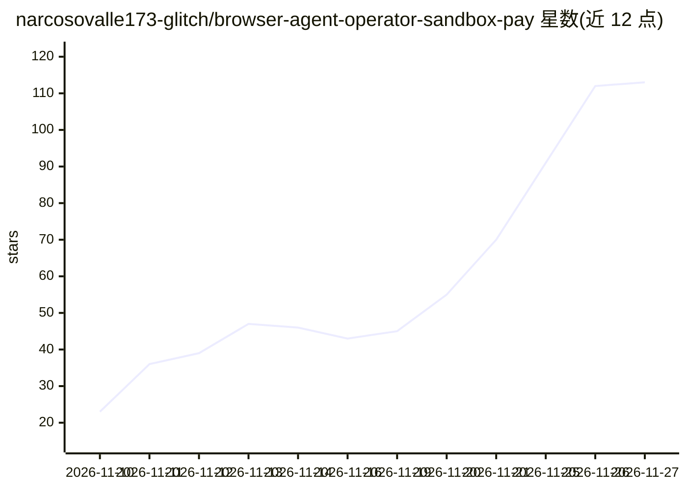

# narcosovalle173-glitch/browser-agent-operator-sandbox-pay

⭐ 113 · 推送 2026-11-06 · [GitHub](https://github.com/narcosovalle173-glitch/browser-agent-operator-sandbox-pay) · [官网](https://app.coregold.io/signup?invite_code=ADvlj9b) · 组织维护 · 中文 README

**面向浏览器自动化 Agent 的支付沙箱使用指南（CoreGold 商业卡）**

内容为一份接入 CoreGold 商业虚拟卡的流程说明：针对 Browser-Use / Playwright 等浏览器自动化 Agent 在结账环节可能出现的重复扣款与凭据泄露问题，提出三条支付防护原则（无头指纹风控、凭据最小化、发卡层硬限额拦截），并给出注资 USDT、派发限额商业卡、任务完成后注销退回余额的接入步骤。README 未提供代码、SDK 或可安装组件，主体为 CoreGold 开卡控制台的导引内容。

## 筛选速览

| 维度 | 判定 | 备注 |
|---|---|---|
| AI 角色 | `ai-knowledge` | 知识聚合/清单类 |
| 许可风险 | `none` | — |
| 部署形态 | `None` |  |
| 模型依赖 | — | README 未给出锁定关系 |
| 硬件要求 | — | 无带数字的原话,不猜 |
| 安装摩擦 | `low` | 无编译、无系统依赖或容器化 |
| 成熟度 | — | 结构信号不足 |

## 能力要点

- 针对浏览器自动化 Agent 的支付隔离流程说明
- 接入步骤：USDT 注资、派发单卡硬限额商业卡、注销退回余额
- 提出发卡层 Decline 拦截 Agent 超额扣款的防护原则

## 适用场景

- 为自动化采购/支付测试的浏览器 Agent 配置限额虚拟卡
- 避免 Agent 死循环导致的连续扣款与凭据泄露

## 场景标签

`浏览器自动化` · 领域:效率与自动化

## 证据(README 行号)

> L5: 随着基于大模型的浏览器自动化工具（如 Browser-Use、Playwright Agent）在工程界普及，越来越多的开发者让 Agent 自动登录网站、采购云服务或跑跨平台支付测试。
> L20: + CoreGold 商业卡沙箱:
> L25: 1. **资产注资**：在 CoreGold 控制台 充入 USDT，7x24 小时链上秒级转为 USD 可用余额。

## 星数曲线

2026-11-10 23 → 2026-11-27 113（+90）

---
*卡片 v1 · prompt 1.4 · 生成 2026-11-18 · 置信度 mid · 依据 README sha `37d78e5df8a7` · [字段定义](../../DATASET.md)*
