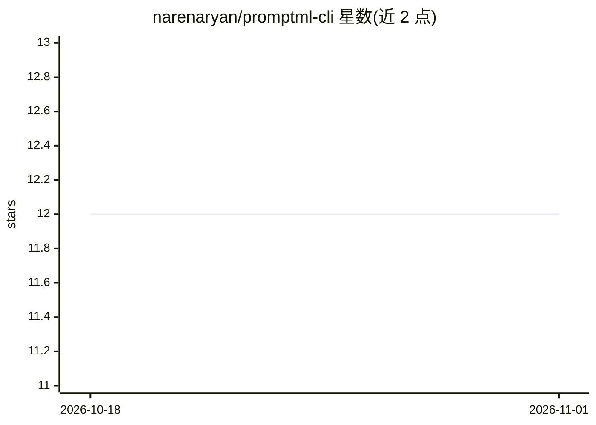

# narenaryan/promptml-cli

⭐ 12 · Python · MIT · 推送 2026-01-03 · [GitHub](https://github.com/narenaryan/promptml-cli) · 个人维护

**运行 PromptML 提示脚本的 CLI 工具，面向 OpenAI/Google/Ollama**

Python 编写的命令行工具，安装后提供 procli 命令，用于在 LLM 上执行 Prompt Markup Language（.pml）脚本文件。支持通过环境变量配置 OpenAI 与 Google API key，也支持本地 Ollama（无需 key），并用 -p/-m 参数选择提供商与模型。默认流式输出响应，可用 --no-stream 改为一次性收集，--raw 可获取无格式原始输出便于管道或存档。README 标注 Claude、Cohere、AI21 支持在 TODO 中。

## 筛选速览

| 维度 | 判定 | 备注 |
|---|---|---|
| AI 角色 | `ai-ecosystem` | LLM/agent 周边工具 |
| 许可风险 | `permissive` | MIT |
| 部署形态 | `library` | 以包/库形式分发 |
| 模型依赖 | local-ok | 支持本地模型 |
| 硬件要求 | — | 无带数字的原话,不猜 |
| 安装摩擦 | `low` | 无编译、无系统依赖或容器化 |
| 成熟度 | — | 结构信号不足 |

## 能力要点

- procli 命令执行 .pml 提示脚本
- 支持 OpenAI、Google GenAI 与本地 Ollama 三种提供商
- 流式/非流式输出切换（--no-stream）
- --raw 输出原始结果便于管道与保存

## 适用场景

- 在终端用 PromptML 脚本快速调用不同 LLM
- 将模型输出管道到其他命令或保存为文件
- 本地 Ollama 离线运行提示脚本

## 场景标签

`提示工程` · 领域:Agent 开发

## 证据(README 行号)

> L2: A CLI application to run PromptML scripts against LLMs.
> L6: pip install --upgrade 'promptml-cli[google,openai]
> L49: procli -f character.pml -p ollama -m phi3

## 星数曲线

2026-10-18 12 → 2026-11-01 12（+0）

---
*卡片 v1 · prompt 1.4 · 生成 2026-11-01 · 置信度 high · 依据 README sha `c048ff1540c0` · [字段定义](../../DATASET.md)*
