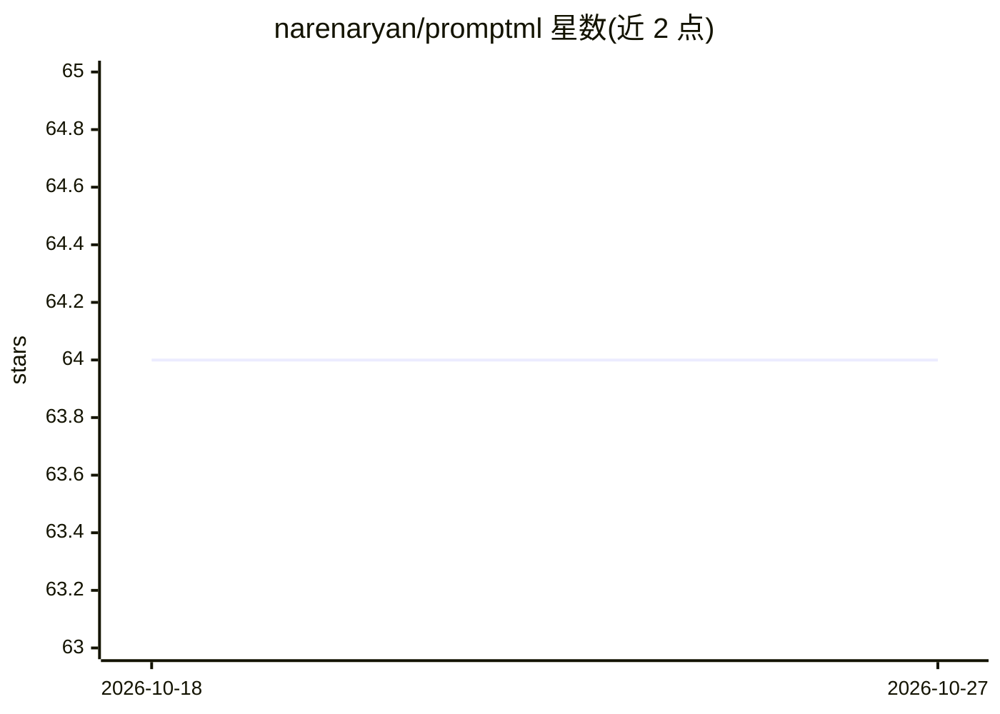

# narenaryan/promptml

⭐ 64 · Python · MIT · 推送 2025-11-03 · [GitHub](https://github.com/narenaryan/promptml) · [官网](https://www.promptml.org) · 个人维护

**提示词领域专用语言 PromptML 的解析库**

Python 编写的提示词标记语言（DSL）库：用 `@` 注解块将提示词拆分为 context、objective、instructions、metadata 等显式段，支持 @vars 变量定义与 $var 引用，文件扩展名 .pml，语法定义在 grammar.lark（受 XML 与 Ruby 影响）。解析后可将同一提示词对象序列化为 XML/YAML/JSON。配套 promptml-cli（另一仓库）可用 OpenAI 与 Google 模型运行 PromptML 程序。面向做提示词工程化与版本管理的开发者。

## 筛选速览

| 维度 | 判定 | 备注 |
|---|---|---|
| AI 角色 | `ai-ecosystem` | LLM/agent 周边工具 |
| 许可风险 | `permissive` | MIT |
| 部署形态 | `library` | 以包/库形式分发 |
| 模型依赖 | — | README 未给出锁定关系 |
| 硬件要求 | — | 无带数字的原话,不猜 |
| 安装摩擦 | `low` | 无编译、无系统依赖或容器化 |
| 成熟度 | — | 结构信号不足 |

## 能力要点

- DSL 将提示词拆为 context/objective/instructions 等显式段
- @vars 变量定义与 $var 引用
- 同一对象可序列化为 XML/YAML/JSON
- 语法基于 grammar.lark，受 XML 与 Ruby 影响

## 适用场景

- 以结构化、可版本管理的方式编写 AI 提示词
- 将 PromptML 提示词序列化为 XML/YAML/JSON 供 LLM 使用
- AI agent 读取 .pml 文件生成对其他 AI 系统的提示

## 场景标签

`提示工程` · 领域:Agent 开发

## 证据(README 行号)

> L5:  A simple, yet elegant markup language for defining AI Prompts as Code (APaC). Built to be used by AI agents to auto
> L9: PromptML is built to provide a way for prompt engineers to define the AI prompts in a deterministic way. This is a D

## 星数曲线

2026-10-18 64 → 2026-10-27 64（+0）

---
*卡片 v1 · prompt 1.4 · 生成 2026-10-24 · 置信度 high · 依据 README sha `a0d376f51f06` · [字段定义](../../DATASET.md)*
