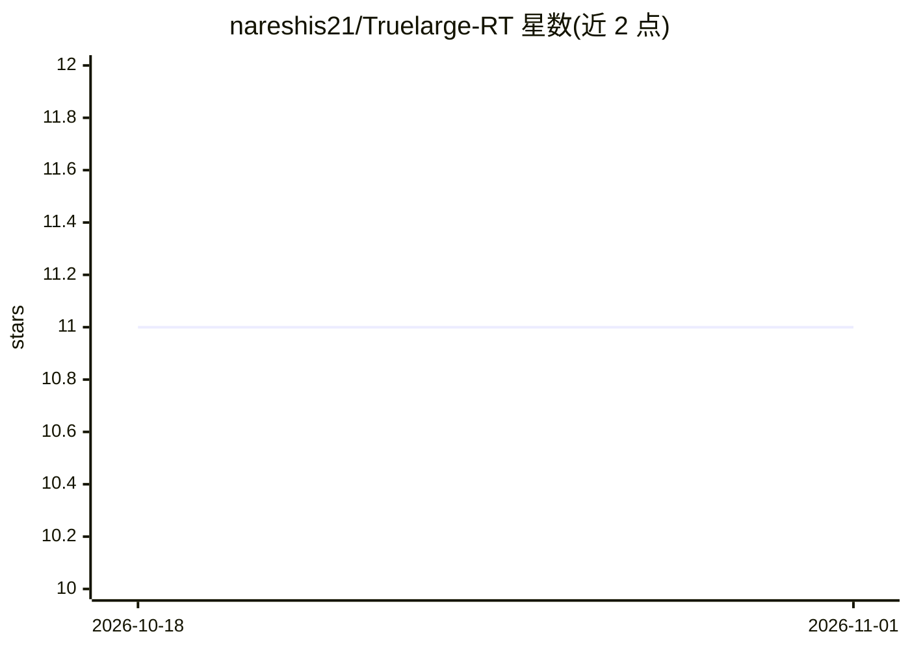

# nareshis21/Truelarge-RT

⭐ 11 · Kotlin · MIT · 推送 2026-02-21 · [GitHub](https://github.com/nareshis21/Truelarge-RT) · 个人维护

**在 4-8GB 内存安卓设备上运行大参数 LLM 的本地推理引擎**

面向消费级 Android 设备的原生 C++/Kotlin LLM 推理引擎，支持 32B+ 参数模型在 4GB-8GB RAM 设备上运行。核心机制是 Deep-Pipelined Layer-by-Layer (LBL) 流式加载：分配约 800MB 固定计算缓冲，逐层从磁盘流式读取权重；另提供 mlock 锁定与 mmap 两种自动切换模式。基于 llama.cpp 构建并带自定义 ARM NEON/DotProd 内核，支持 GGUF 模型（Llama 3、Qwen 2.5、Mistral、Phi-3 等），以 Android Studio 工程形式分发需自行构建 APK。基准数据显示大模型下 TPS 很低（70B 约 0.01-0.04 TPS）。

## 筛选速览

| 维度 | 判定 | 备注 |
|---|---|---|
| AI 角色 | `ai-ecosystem` | LLM/agent 周边工具 |
| 许可风险 | `permissive` | MIT |
| 部署形态 | `None` |  |
| 模型依赖 | local-ok | 支持本地模型 |
| 硬件要求 | — | 无带数字的原话,不猜 |
| 安装摩擦 | `low` | 无编译、无系统依赖或容器化 |
| 成熟度 | — | 结构信号不足 |

## 能力要点

- LBL 模式逐层从磁盘流式加载权重，约 800MB 固定计算缓冲
- 三种执行模式（Turbo/mlock、Balanced/mmap、LBL）按可用 RAM 自动选择
- 基于 llama.cpp，支持 FP16/Q4_K_M 等 GGUF 模型，无需量化即可运行
- Eager Prefetch 预取 3 层、Ping-Pong 双缓冲等 I/O 优化

## 适用场景

- 在低内存旧款安卓手机上本地运行大参数 LLM
- 受 RAM 限制无法整模型加载的边缘设备推理
- 研究磁盘流式推理在 UFS 存储上的可行性

## 场景标签

`推理引擎` · 领域:训练与推理

## 证据(README 行号)

> L15: **TrueLarge-RT** is a high-performance native inference engine that enables **32B+ parameter LLMs** to run on consu
> L39: The core innovation of TrueLarge-RT. It allocates a small, fixed compute buffer (approx. 800MB) and streams model w

## 星数曲线

2026-10-18 11 → 2026-11-01 11（+0）

---
*卡片 v1 · prompt 1.4 · 生成 2026-11-01 · 置信度 high · 依据 README sha `44a545706dcd` · [字段定义](../../DATASET.md)*
