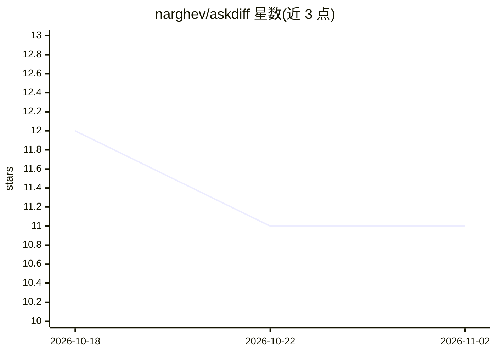

# narghev/askdiff

⭐ 11 · TypeScript · MIT · 推送 2026-05-11 · [GitHub](https://github.com/narghev/askdiff) · [官网](https://www.npmjs.com/package/askdiff) · 个人维护

**在 Claude Code 会话内审阅 git diff 并向模型提问的工具**

以 Claude Code skill 形式安装的 diff 审阅工具：输入 /askdiff 在浏览器打开语法高亮的 diff 视图，悬停行点击 + 即可对选中行提问，回答以流式内联返回。关键机制是每次提问通过 claude CLI --resume 恢复写代码的同一会话，无需向模型重发 diff，也不需要额外的 Anthropic API key；支持自然语言描述选择 diff 与跨会话定位（30 天内、前 5 候选）。服务器 5 分钟无活动自动退出。

## 筛选速览

| 维度 | 判定 | 备注 |
|---|---|---|
| AI 角色 | `ai-ecosystem` | LLM/agent 周边工具 |
| 许可风险 | `permissive` | MIT |
| 部署形态 | `library` | 以包/库形式分发 |
| 模型依赖 | — | README 未给出锁定关系 |
| 硬件要求 | — | 无带数字的原话,不猜 |
| 安装摩擦 | `low` | 无编译、无系统依赖或容器化 |
| 成熟度 | — | 结构信号不足 |

## 能力要点

- 浏览器内 GitHub 风格 diff 视图，逐行/范围提问
- 提问通过 claude CLI --resume 复用原会话上下文，不重发 diff
- 自然语言选择 diff（工作区/任意提交区间/分支对比）与跨会话定位
- 流式回答、线程式追问、30+ 语言语法高亮

## 适用场景

- 让 AI 写完代码后直接在 diff 上追问某行为什么这样改
- 回看历史提交并在当时写代码的会话里提问
- 大 diff 场景下替代手工开草稿 PR 审阅

## 场景标签

`代码审查` · 领域:编码与开发

## 证据(README 行号)

> L9: `/askdiff` from inside any Claude Code session opens a GitHub-style diff
> L62: Each ask spawns the `claude` CLI with `--resume <your-session-id>`.
> L67: - **No Anthropic API key needed.** askdiff doesn't talk to the API —

## 星数曲线

2026-10-18 12 → 2026-11-02 11（-1）

---
*卡片 v1 · prompt 1.4 · 生成 2026-11-01 · 置信度 high · 依据 README sha `89a4be907769` · [字段定义](../../DATASET.md)*
