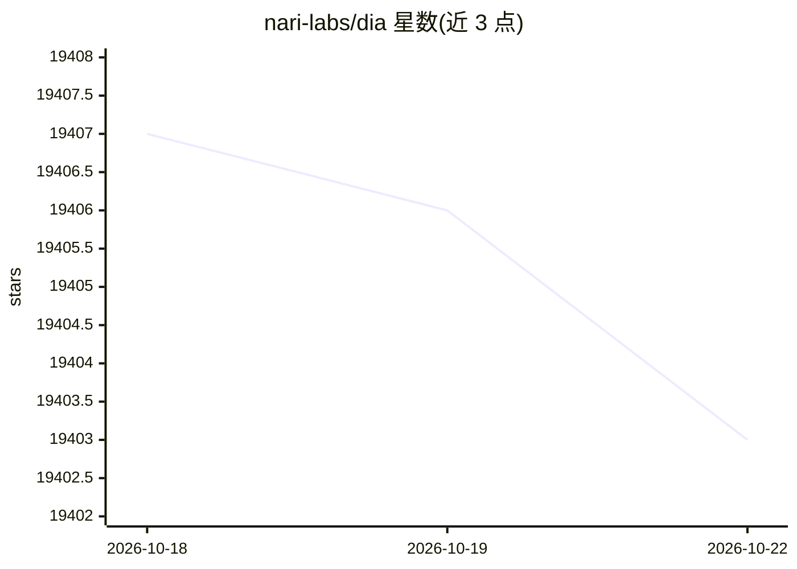

# nari-labs/dia

⭐ 19,406 · Python · Apache-2.0 · 推送 2025-11-19 · [GitHub](https://github.com/nari-labs/dia) · 组织维护

**单次生成超真实对话的 1.6B 文本转语音模型**

Nari Labs 开源的 1.6B 参数 TTS 模型，从文本一次生成对话语音，支持 [S1]/[S2] 说话人标签、笑声咳嗽等非语言标记，以及基于音频提示的语音克隆与情感语调控制。权重托管在 Hugging Face，可通过 Transformers 库或本仓库推理代码运行；目前仅支持英文，仅支持 GPU 推理（pytorch 2.0+/CUDA 12.6），Apache 2.0 许可，面向研究与教育用途。bfloat16 下 VRAM 约 4.4GB。

## 筛选速览

| 维度 | 判定 | 备注 |
|---|---|---|
| AI 角色 | `ai-native` | 本体是模型或模型工具 |
| 许可风险 | `permissive` | Apache-2.0 |
| 部署形态 | `library` | 以包/库形式分发 |
| 模型依赖 | — | README 未给出锁定关系 |
| 硬件要求 | — | 无带数字的原话,不猜 |
| 安装摩擦 | `medium` | 含编译或系统依赖之一 |
| 成熟度 | `idea` | |

## 动量与使用信号

- 维护:`declining` — 距上次 push 332.5 天,年发版 0,20 位贡献者
- 涨星:近 1 天 **-1**(自 20261016 起算)
- 安装:pypi 包 `git` 月下载无数据

## 能力要点

- [S1]/[S2] 标签一次生成多说话人对话
- 语音克隆：上传 5-10 秒音频加转写作为提示
- 支持 (laughs)、(coughs) 等 21 种非语言标记
- 已接入 Hugging Face Transformers（DiaForConditionalGeneration）

## 适用场景

- 从剧本文本直接生成双人对话播客或配音素材
- 通过音频提示克隆音色并控制情感语调
- TTS 语音生成研究与实验

## 场景标签

`语音合成` · 领域:内容生成

## 证据(README 行号)

> L12: Dia is a 1.6B parameter text to speech model created by Nari Labs.
> L18: Dia **directly generates highly realistic dialogue from a transcript**. You can condition the output on audio, enab
> L142: Dia has been tested on only GPUs (pytorch 2.0+, CUDA 12.6). CPU support is to be added soon.

## 星数曲线

2026-10-18 19,407 → 2026-10-22 19,403（-4）

---
*卡片 v1 · prompt 1.4 · 生成 2026-10-18 · 置信度 high · 依据 README sha `9aa5a2a449cd` · [字段定义](../../DATASET.md)*
