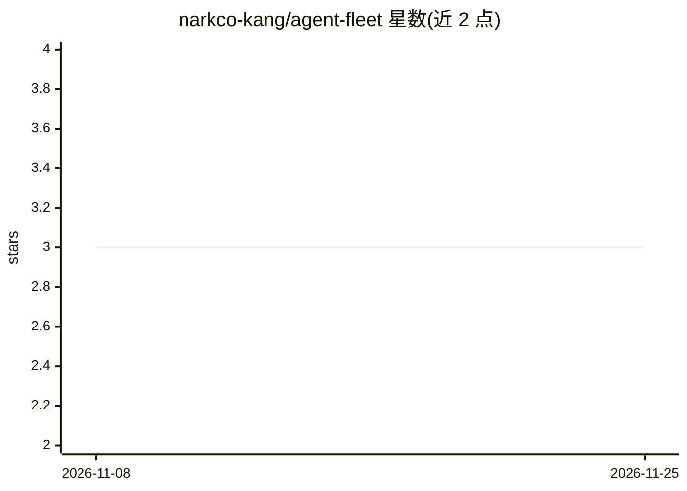

# narkco-kang/agent-fleet

⭐ 3 · TypeScript · MIT · 推送 2026-11-08 · [GitHub](https://github.com/narkco-kang/agent-fleet) · 个人维护 · 中文 README

**自托管跨设备 AI agent 编排层：统一调度已装编码 agent**

自托管的跨设备 AI 编排层，不重建 agent，而是把用户已安装的 Claude Code、Codex、Cursor、Aider、Gemini、Qwen 等平台（共映射 14 个）纳入统一调度：跨设备任务分发/流式/取消、实时神经图可视化、基于哈希链+Merkle 树+Ed25519 签名的防篡改共享记忆账本、OpenAI 兼容路由网关与角色路由、设备故障约 1 秒检测与任务零丢失迁移、Excel 批量部署。面向开发者在局域网内多机管理多个编码 agent。需 Node.js v24，MIT 许可。

## 筛选速览

| 维度 | 判定 | 备注 |
|---|---|---|
| AI 角色 | `ai-ecosystem` | LLM/agent 周边工具 |
| 许可风险 | `permissive` | MIT |
| 部署形态 | `library` | 以包/库形式分发 |
| 模型依赖 | — | README 未给出锁定关系 |
| 硬件要求 | — | 无带数字的原话,不猜 |
| 安装摩擦 | `low` | 无编译、无系统依赖或容器化 |
| 成熟度 | — | 结构信号不足 |

## 能力要点

- 自动检测 14 个 agent 平台并统一任务协议（submit/stream/cancel）
- 防篡改记忆账本：哈希链 + Merkle 树 + Ed25519 签名 + BM25 搜索
- 设备死亡约 1 秒检测，运行中任务重排队零丢失迁移
- Excel 批量部署：探测 OS、引导安装 npm/pipx/brew/winget 并逐一验证

## 适用场景

- 在局域网多台机器上集中运行和监控多个编码 agent
- 设备中途掉线时把任务连同部分输出迁移到其他设备
- 通过路由网关按角色分发任务到指定设备+agent+模型
- 用仪表盘实时查看设备→agent→任务的运行状态图

## 场景标签

`Agent 框架` `多智能体` `模型网关` · 领域:Agent 开发

## 证据(README 行号)

> L5: AgentFleet is a **self-hosted cross-device AI orchestration layer**. It doesn't build new agents — it coordinates th
> L56: |**Cross-device orchestration**|Auto-detect 14 AI agent platforms per device via a data-driven adapter catalog; uni
> L60: |**Smart routing gateway**|Built-in modelgateway workspace with an OpenAI-compatible endpoint; role-based routing (

## 星数曲线

2026-11-08 3 → 2026-11-25 3（+0）

---
*卡片 v1 · prompt 1.4 · 生成 2026-11-21 · 置信度 high · 依据 README sha `ec88dfde410a` · [字段定义](../../DATASET.md)*
