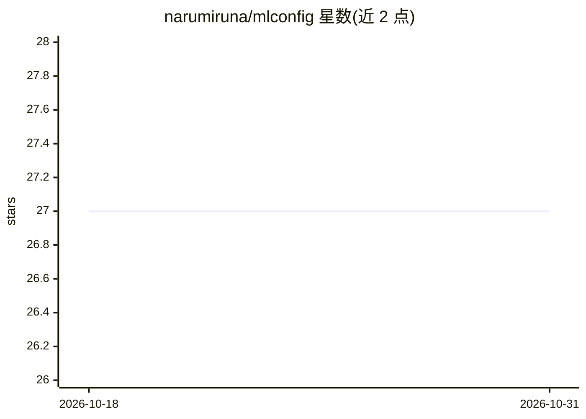

# narumiruna/mlconfig

⭐ 27 · Python · MIT · 推送 2026-10-29 · [GitHub](https://github.com/narumiruna/mlconfig) · 个人维护

**基于 OmegaConf 的 YAML 配置加载与对象实例化 Python 库**

构建在 OmegaConf 之上的轻量级配置加载与对象实例化辅助库：从 YAML 文件、结构化对象或两者合并加载配置，通过注册表机制按配置中的 name 字段实例化已注册的函数或类，剩余字段作为关键字参数传入。核心 API 包括 load/register/instantiate/instantiate_as/getcls/flatten，另提供 PyTorch 优化器与调度器的注册辅助函数。要求 Python>=3.12、OmegaConf>=2.3.0，MIT 许可。

## 筛选速览

| 维度 | 判定 | 备注 |
|---|---|---|
| AI 角色 | `ai-ecosystem` | LLM/agent 周边工具 |
| 许可风险 | `permissive` | MIT |
| 部署形态 | `library` | 以包/库形式分发 |
| 模型依赖 | — | README 未给出锁定关系 |
| 硬件要求 | — | 无带数字的原话,不猜 |
| 安装摩擦 | `low` | 无编译、无系统依赖或容器化 |
| 成熟度 | — | 结构信号不足 |

## 能力要点

- load 支持文件、结构化对象及二者合并加载（文件覆盖对象）
- register/instantiate 注册表机制按 name 字段构造函数或类
- instantiate_as 实例化并校验类型，flatten 扁平化嵌套字典
- 提供 PyTorch optimizer/scheduler 注册辅助函数

## 适用场景

- 机器学习项目中用 YAML 统一管理模型、优化器等组件配置
- 从配置文件按名称动态实例化 PyTorch 类
- 合并与覆盖默认配置对象

## 场景标签

 · 领域:机器学习/开发工具

## 证据(README 行号)

> L3: `mlconfig` is a lightweight configuration loader and object instantiation helper built on top of
> L4: OmegaConf. It is useful when a Python project needs YAML-based
> L113: ## PyTorch Helpers

## 星数曲线

2026-10-18 27 → 2026-10-31 27（+0）

---
*卡片 v1 · prompt 1.4 · 生成 2026-10-26 · 置信度 high · 依据 README sha `d88e373851f7` · [字段定义](../../DATASET.md)*
