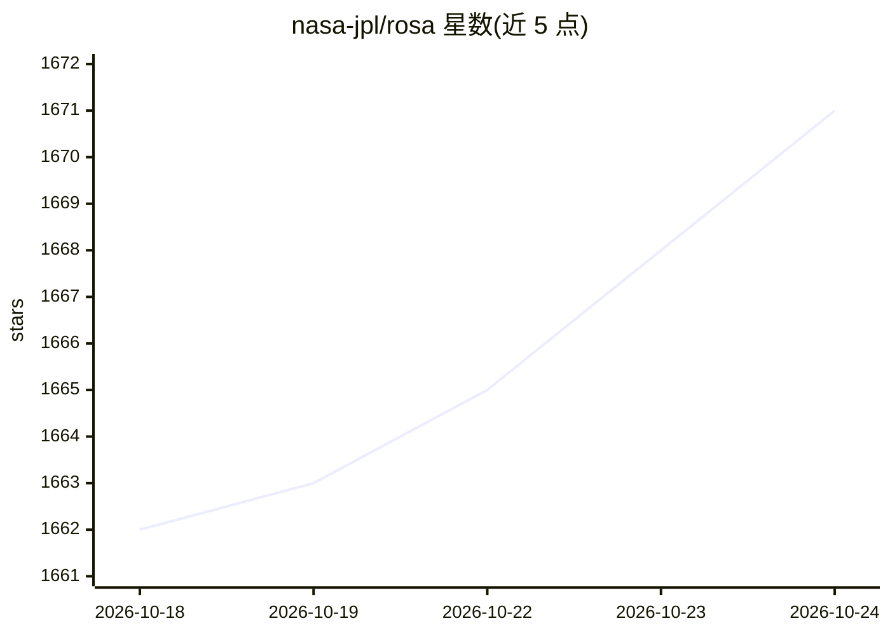

# nasa-jpl/rosa

⭐ 1,672 · Python · Apache-2.0 · 推送 2026-03-17 · [GitHub](https://github.com/nasa-jpl/rosa) · [官网](https://github.com/nasa-jpl/rosa/wiki) · 组织维护

**用自然语言查询与操控 ROS1/ROS2 机器人系统的 AI Agent**

面向机器人开发者的 AI 助手：基于 Langchain 框架构建 Agent，通过自然语言对 ROS1/ROS2 系统进行话题查询、诊断与操控，可调用任意自备的 LLM。开发者可通过继承 ROSA 类或自定义参数与工具，将其适配到不同机器人与仿真环境。提供 TurtleSim 演示（需 Docker），并计划推出 IsaacSim 直接集成扩展。要求 Python 3.9+ 与 ROS Noetic 及以上。

## 筛选速览

| 维度 | 判定 | 备注 |
|---|---|---|
| AI 角色 | `ai-native` | 本体是模型或模型工具 |
| 许可风险 | `permissive` | Apache-2.0 |
| 部署形态 | `library` | 以包/库形式分发 |
| 模型依赖 | — | README 未给出锁定关系 |
| 硬件要求 | — | 无带数字的原话,不猜 |
| 安装摩擦 | `low` | 无编译、无系统依赖或容器化 |
| 成熟度 | — | 结构信号不足 |

## 能力要点

- 自然语言查询/诊断/操控 ROS1 与 ROS2 系统
- 基于 Langchain 框架，LLM 由用户自行配置
- 支持继承 ROSA 类创建自定义 Agent 与工具
- 包含 TurtleSim 仿真演示（Docker 运行）

## 适用场景

- 用自然语言检查话题、诊断机器人系统状态
- 为自己的机器人平台定制自然语言控制 Agent
- 在仿真环境（TurtleSim/IsaacSim）中操控机器人

## 场景标签

`Agent 框架` `AI 助手` · 领域:Agent 开发

## 证据(README 行号)

> L5:  The ROS Agent (ROSA) is designed to interact with ROS-based robotics systems using natural language queries. 🗣️🤖
> L22: ROSA is your AI-powered assistant for ROS1 and ROS2 systems. Built on the Langchain framework, ROSA helps you inter
> L44: agent = ROSA(ros_version=1, llm=llm)

## 星数曲线

2026-10-18 1,662 → 2026-10-24 1,671（+9）

---
*卡片 v1 · prompt 1.4 · 生成 2026-10-21 · 置信度 high · 依据 README sha `5f5525ec2a13` · [字段定义](../../DATASET.md)*
