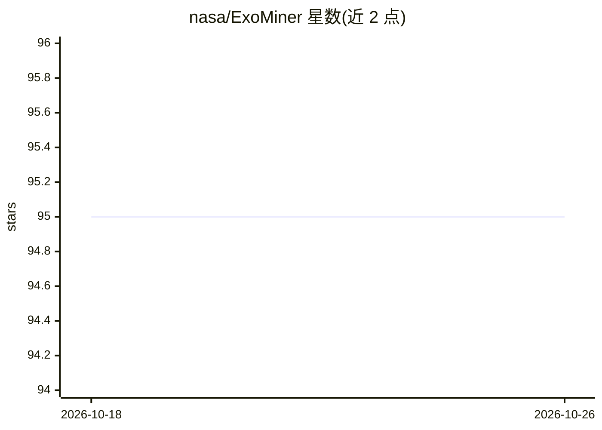

# nasa/ExoMiner

⭐ 95 · Python · 推送 2026-10-13 · [GitHub](https://github.com/nasa/ExoMiner) · 组织维护

**NASA 开发的系外行星候选自动识别与验证深度学习分类器**

NASA Ames 研究中心数据科学组开发的深度学习管道，对 Kepler/TESS 凌星测光数据中的凌星信号（TCE）做分类、生成审查目录并验证新系外行星，向领域专家提供预测分数。仓库包含数据预处理、模型训练/评估/预测、交叉验证与超参优化模块，当前实现 ExoMiner++ 架构（用于 TESS）。提供基于 Podman 容器的端到端管道，从 TIC ID 输入直接产出预测分数，也支持不使用 Podman 运行。相关成果发表于 Astrophysical Journal 与 Astronomical Journal，并附 Zenodo 数据仓库与交互式审查目录。

## 筛选速览

| 维度 | 判定 | 备注 |
|---|---|---|
| AI 角色 | `ai-native` | 本体是模型或模型工具 |
| 许可风险 | `none` | — |
| 部署形态 | `None` |  |
| 模型依赖 | — | README 未给出锁定关系 |
| 硬件要求 | — | 无带数字的原话,不猜 |
| 安装摩擦 | `low` | 无编译、无系统依赖或容器化 |
| 成熟度 | — | 结构信号不足 |

## 能力要点

- 对 Kepler/TESS 凌星信号做深度学习分类与候选验证
- ExoMiner++ 架构，覆盖预处理、训练、交叉验证、超参优化
- Podman 容器化端到端管道：TIC ID 输入到预测分数

## 适用场景

- 自动筛选 Kepler/TESS 测光数据中的行星候选并提示领域专家
- 为系外行星社区生成经审查的 TCE 目录
- 在公开测光数据上复现训练与推理流程

## 场景标签

 · 领域:天体物理/系外行星探测

## 证据(README 行号)

> L9: This project's mission is to develop, test, and deploy automated machine learning-based methods to sift ('mine') thr
> L17: 1. Perform classification of transit signals in Kepler and TESS data;

## 星数曲线

2026-10-18 95 → 2026-10-26 95（+0）

---
*卡片 v1 · prompt 1.4 · 生成 2026-10-23 · 置信度 high · 依据 README sha `696190865a78` · [字段定义](../../DATASET.md)*
