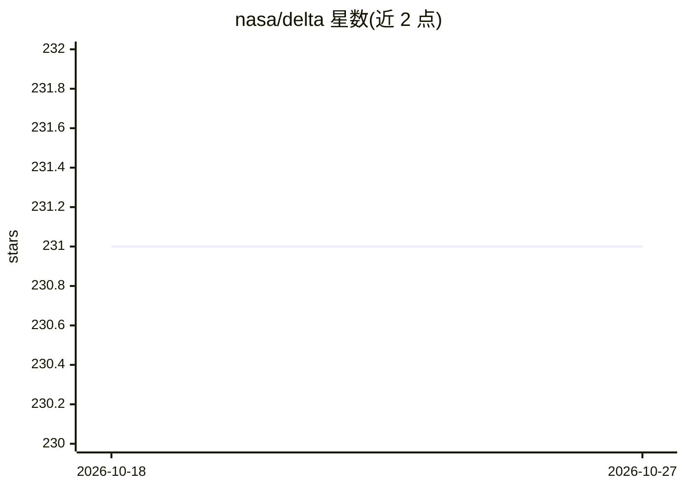

# nasa/delta

⭐ 231 · Python · Apache-2.0 · 推送 2026-09-23 · [GitHub](https://github.com/nasa/delta)

**NASA 的卫星影像深度学习分类框架**

DELTA 是基于 TensorFlow 的卫星影像深度学习框架，用神经网络对大幅遥感影像做像素级分类，自动完成大图分块处理。由 NASA Ames 智能机器人组开发，初期与美国地质调查局等机构合作用于灾害响应的洪水制图。安装需 Python3、GDAL 与 TensorFlow，支持 pip 或 Conda 两种方式，可选 GPU 与 ESA SNAP（处理 Sentinel-1）。提供命令行工具与 Python 库两种用法，通过 YAML 配置训练与分类，支持 MLFlow 记录训练，并可扩展自定义网络层与图像类型。README 载明开发持续至 2021 年底。

## 筛选速览

| 维度 | 判定 | 备注 |
|---|---|---|
| AI 角色 | `ai-native` | 本体是模型或模型工具 |
| 许可风险 | `permissive` | Apache-2.0 |
| 部署形态 | `library` | 以包/库形式分发 |
| 模型依赖 | — | README 未给出锁定关系 |
| 硬件要求 | — | 无带数字的原话,不猜 |
| 安装摩擦 | `medium` | 含编译或系统依赖之一 |
| 成熟度 | — | 结构信号不足 |

## 能力要点

- 大幅卫星影像的神经网络分类，自动分块处理
- YAML 配置驱动训练与分类，支持命令行与 Python 库两种用法
- 集成 MLFlow 记录训练指标与配置
- 可扩展自定义网络层、图像类型、预处理与损失函数

## 适用场景

- 用 Landsat-8 影像训练云覆盖分类网络
- 灾害响应中对卫星影像做洪水制图
- 遥感科研中定制像素级地物分类流程

## 场景标签

`目标检测` · 领域:感知与多模态

## 证据(README 行号)

> L1: **DELTA** (Deep Earth Learning, Tools, and Analysis) is a framework for deep learning on satellite imagery,
> L2: based on Tensorflow. DELTA classifies large satellite images with neural networks, automatically handling
> L70: As a simple example, consider training a neural network to map clouds with Landsat-8 images.

## 星数曲线

2026-10-18 231 → 2026-10-27 231（+0）

---
*卡片 v1 · prompt 1.4 · 生成 2026-10-22 · 置信度 high · 依据 README sha `4f6549edfd53` · [字段定义](../../DATASET.md)*
