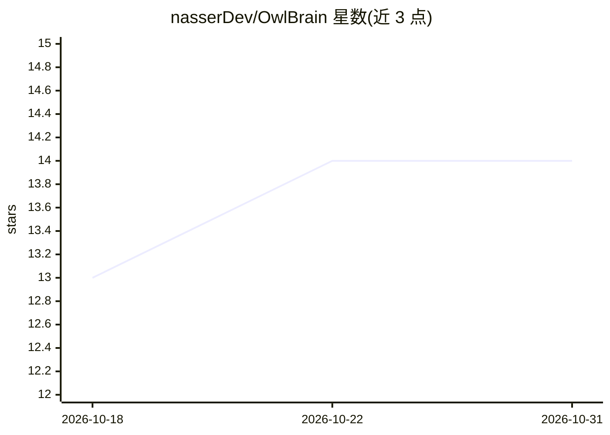

# nasserDev/OwlBrain

⭐ 14 · TypeScript · NOASSERTION · 推送 2026-03-18 · [GitHub](https://github.com/nasserDev/OwlBrain) · [官网](http://owlbrain.ai) · 个人维护

**多 LLM 结构化辩论平台：五个 AI 代理互相辩论并产出裁决**

基于 React/Node.js/Express 的 Web 应用：用户提交商业案例，五个具不同角色的代理（策略、量化、风险、创新、魔鬼代言人）可分别指派给 Claude、GPT、Gemini 模型进行多轮辩论，独立裁判按五个维度打共识分（0-100），综合器生成附完整记录的最终裁决。支持 18 个模型、实时流式输出、Web 搜索、SQLite 持久化与公开演示模式（限额/锁模型）。需 Node.js 20+ 与至少一个 API key，源码以 BSL 1.1 提供。

## 筛选速览

| 维度 | 判定 | 备注 |
|---|---|---|
| AI 角色 | `ai-native` | 本体是模型或模型工具 |
| 许可风险 | `none` | NOASSERTION |
| 部署形态 | `library` | 以包/库形式分发 |
| 模型依赖 | locked-api |  |
| 硬件要求 | — | 无带数字的原话,不猜 |
| 安装摩擦 | `low` | 无编译、无系统依赖或容器化 |
| 成熟度 | — | 结构信号不足 |

## 能力要点

- 五角色代理可分别指派不同厂商模型进行多轮辩论
- 独立裁判跨五维度打共识分并检测迎合性共识
- 18 个模型覆盖 Anthropic/OpenAI/Google 三家，新增模型仅需一条目录条目
- 演示模式含每日 token 上限、IP 限额与模型锁定

## 适用场景

- 提交商业决策案例让多个模型辩论后获得综合裁决
- 对比不同 LLM 对同一问题的推理分歧
- 对公开展示带限额保护的 AI 辩论演示站

## 场景标签

`多智能体` `模型评测` · 领域:Agent 开发

## 证据(README 行号)

> L5: > **OwlBrain pits five specialised AI agents against each other in structured, multi-round debates about any busines
> L56: 🔀 **Multi-LLM Orchestration** — Assign different models to different agents. Run Claude as your strategist, GPT as 
> L74: 📝 **Synthesis & Verdict** — A dedicated synthesizer produces a structured final report that references the full tra

## 星数曲线

2026-10-18 13 → 2026-10-31 14（+1）

---
*卡片 v1 · prompt 1.4 · 生成 2026-10-31 · 置信度 high · 依据 README sha `bccf486a2ef3` · [字段定义](../../DATASET.md)*
