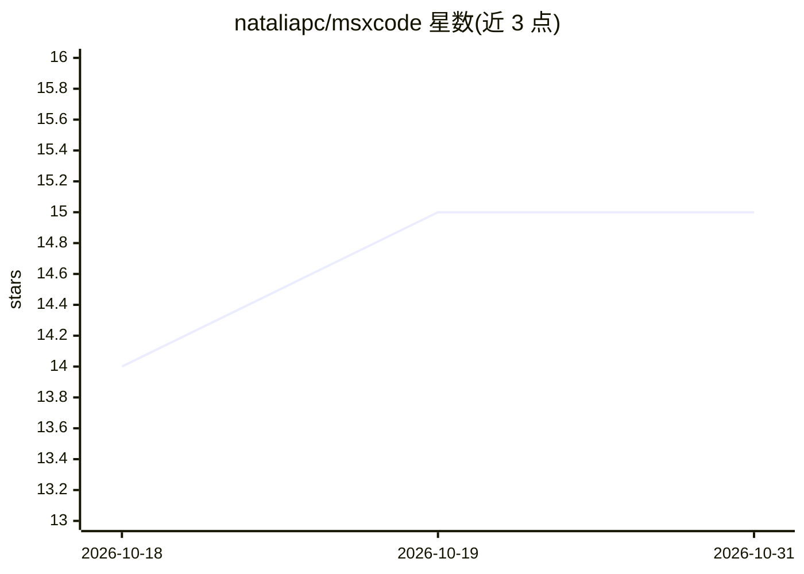

# nataliapc/msxcode

⭐ 15 · C · GPL-2.0 · 推送 2026-08-08 · [GitHub](https://github.com/nataliapc/msxcode) · 个人维护

**MSX2 8 位机上的 AI 聊天客户端，连接 OpenAI 兼容 API**

用 C 与 Z80 汇编编写、运行于 MSX-DOS 2 的 AI 助手客户端：通过 TCP/IP UNAPI 设备连接 OpenAI 兼容的 /v1/chat/completions 接口，在 Screen 7 的 85 列图形文本界面中呈现对话。支持多轮会话（存储于内存映射段）、可选 bearer 认证、会话导出磁盘，以及只读的函数调用工具（列目录/读文件/取系统时间与信息）。HTTPS 尚未完整实现，仅支持 http:// 端点。面向 MSX2/MSX2+/turbo R 及 FPGA 核心的复古计算机用户。

## 筛选速览

| 维度 | 判定 | 备注 |
|---|---|---|
| AI 角色 | `ai-native` | 本体是模型或模型工具 |
| 许可风险 | `viral` | GPL-2.0 |
| 部署形态 | `None` |  |
| 模型依赖 | local-ok | 支持本地模型 |
| 硬件要求 | — | 无带数字的原话,不猜 |
| 安装摩擦 | `low` | 无编译、无系统依赖或容器化 |
| 成熟度 | `idea` | |

## 能力要点

- OpenAI 兼容 /v1/chat/completions 客户端，经 TCP/IP UNAPI 通信
- 多轮会话历史存储于内存映射段，会话可导出磁盘
- 函数调用工具（listDir/readFile/getDateTime/getSysInfo，只读）
- UTF-8 回答转换为 MSX 字符集的 Screen 7 图形界面

## 适用场景

- 在实体或模拟的 MSX2 及以上机器上与 LLM 对话
- 通过本地 Ollama 服务器等 OpenAI 兼容端点使用自选模型
- 让模型以只读方式查看 MSX-DOS 文件与系统信息

## 场景标签

`AI 助手` `聊天机器人` · 领域:对话与助手

## 证据(README 行号)

> L3: `msxcode` is an AI assistant client for MSX computers. It runs as an
> L14: - OpenAI-compatible `/v1/chat/completions` client

## 星数曲线

2026-10-18 14 → 2026-10-31 15（+1）

---
*卡片 v1 · prompt 1.4 · 生成 2026-10-30 · 置信度 high · 依据 README sha `bac04504b2c3` · [字段定义](../../DATASET.md)*
