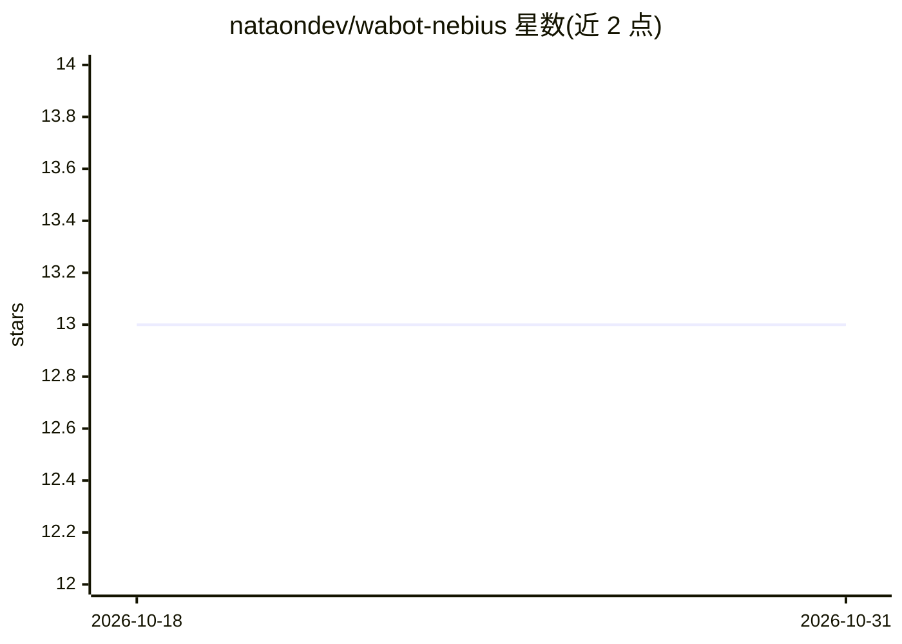

# nataondev/wabot-nebius

⭐ 13 · TypeScript · 推送 2026-04-27 · [GitHub](https://github.com/nataondev/wabot-nebius) · 个人维护 · 中文 README

**连接 Nebius AI 的 WhatsApp 聊天机器人模板（Bun + Baileys）**

基于 Bun/TypeScript 与 Baileys 库的 WhatsApp 机器人：通过 QR 登录 WhatsApp 收发消息，调用 Nebius AI Studio（OpenAI 兼容 API）的 LLM 生成回复，支持重试与超时处理。内置按主题的自动摘要记忆以节省 token、persona/policy 注入、群组白名单热重载、自定义插件热加载（优先于 LLM 执行）与三种运行模式。数据存储用 Bun 自带的 bun:sqlite，无需原生编译。面向需要快速搭建 WA AI 助手的开发者，需自备 NEBIUS_API_KEY。

## 筛选速览

| 维度 | 判定 | 备注 |
|---|---|---|
| AI 角色 | `ai-native` | 本体是模型或模型工具 |
| 许可风险 | `none` | — |
| 部署形态 | `None` |  |
| 模型依赖 | — | README 未给出锁定关系 |
| 硬件要求 | — | 无带数字的原话,不猜 |
| 安装摩擦 | `low` | 无编译、无系统依赖或容器化 |
| 成熟度 | — | 结构信号不足 |

## 能力要点

- Baileys QR 登录 WhatsApp 收发消息与 typing 状态
- 调用 Nebius（OpenAI 兼容）LLM 回复，带重试/超时
- 按主题摘要记忆与主题切换检测，节省 token
- custom/ 插件热加载，优先于 LLM 执行；groups.txt 白名单热重载

## 适用场景

- 搭建接入 LLM 的个人或群组 WhatsApp AI 助手
- 以模板为基础快速定制自己的 WA 聊天机器人
- 通过插件扩展额外功能且不打扰核心代码

## 场景标签

`聊天机器人` `AI 助手` · 领域:对话与助手

## 证据(README 行号)

> L8: - Jawab pakai LLM Nebius (retry + timeout)
> L21: - OpenAI SDK (baseURL Nebius)

## 星数曲线

2026-10-18 13 → 2026-10-31 13（+0）

---
*卡片 v1 · prompt 1.4 · 生成 2026-10-31 · 置信度 high · 依据 README sha `9266e3b08627` · [字段定义](../../DATASET.md)*
