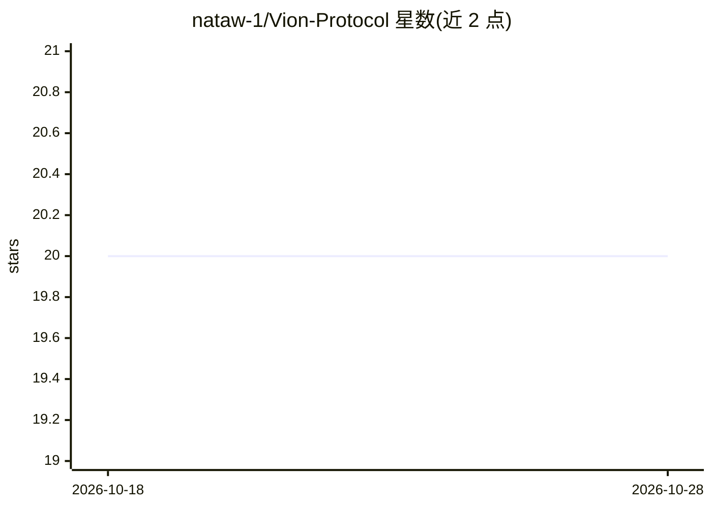

# nataw-1/Vion-Protocol

⭐ 20 · Python · MIT · 推送 2026-09-03 · [GitHub](https://github.com/nataw-1/Vion-Protocol) · 个人维护

**给 AI agent 运行时加宪法治理：规则、身份、审计与自动熔断**

面向自主 AI agent 的治理运行时：以 VION.md 宪法文件与 IDENTITY.md 代理注册表定义规则和身份，对任务命令做验证管线，权限受范围、行动上限和授权有效期约束。执行六类 HALT/ESCALATE 熔断条件（未授权命令源、范围违规、点对点通信、审计失败、风险上限、宪法完整性违规），事件日志经 SHA-256 哈希链实现防篡改审计。提供 LangChain、CrewAI、OpenAI 等框架适配器，通过 pip 安装。

## 筛选速览

| 维度 | 判定 | 备注 |
|---|---|---|
| AI 角色 | `ai-ecosystem` | LLM/agent 周边工具 |
| 许可风险 | `permissive` | MIT |
| 部署形态 | `library` | 以包/库形式分发 |
| 模型依赖 | — | README 未给出锁定关系 |
| 硬件要求 | — | 无带数字的原话,不猜 |
| 安装摩擦 | `low` | 无编译、无系统依赖或容器化 |
| 成熟度 | — | 结构信号不足 |

## 能力要点

- VION.md 宪法 + IDENTITY.md 代理注册表的规则与身份体系
- 六类自动 HALT/ESCALATE 熔断条件，无需人工介入
- SHA-256 哈希链防篡改审计日志，提供链校验 API
- 支持 LangChain/CrewAI/OpenAI 及任意 Python agent 的适配器

## 适用场景

- 生产环境 agent 执行金融交易或删库等高危操作前自动拦截
- 跨框架统一治理多个自主 agent 的权限与行为
- 生成可校验的会话审计报告用于事后追责

## 场景标签

`Agent 框架` `网络安全` · 领域:Agent 开发

## 证据(README 行号)

> L11: **Constitutional governance runtime for autonomous AI agents.**
> L13: VION Protocol governs AI agents with constitutional law — defined rules, verified identities, bounded permissions, 
> L89: ## Supported Agent Frameworks

## 星数曲线

2026-10-18 20 → 2026-10-28 20（+0）

---
*卡片 v1 · prompt 1.4 · 生成 2026-10-28 · 置信度 high · 依据 README sha `b58bd3e00ee9` · [字段定义](../../DATASET.md)*
