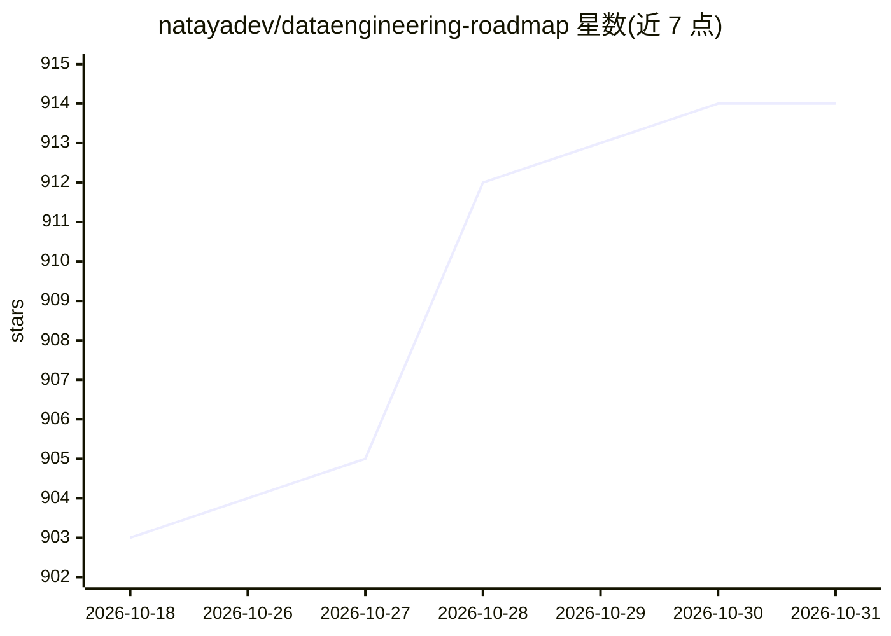

# natayadev/dataengineering-roadmap

⭐ 914 · MIT · 推送 2026-02-28 · [GitHub](https://github.com/natayadev/dataengineering-roadmap) · [官网](https://natayadev.github.io/dataengineering-roadmap/) · 个人维护

**西班牙语数据工程学习路线图：免费资源与挑战清单**

个人维护的西语数据工程学习资源清单，按编程、数据库、Big Data、数据处理、云与求职六个阶段组织，收录课程、视频、书籍、认证与社区频道等免费材料，每条标注难度级别（初/中/高）与语言。Big Data 部分含人工智能、商业智能与数据分析的入门资源。另发起 #100DiasDeIngenieriaDeDatos 技术挑战，接受社区贡献，作者声明这是个人标准的资源列表而非权威指南。

## 筛选速览

| 维度 | 判定 | 备注 |
|---|---|---|
| AI 角色 | `ai-knowledge` | 知识聚合/清单类 |
| 许可风险 | `permissive` | MIT |
| 部署形态 | `None` |  |
| 模型依赖 | — | README 未给出锁定关系 |
| 硬件要求 | — | 无带数字的原话,不猜 |
| 安装摩擦 | `low` | 无编译、无系统依赖或容器化 |
| 成熟度 | — | 结构信号不足 |

## 能力要点

- 六大阶段的学习路线：编程→数据库→Big Data→数据处理→云→求职
- 条目标注难度级别图标与语言，多数资源为西语免费材料
- 包含 #100DiasDeIngenieriaDeDatos 技术挑战与设计模式等延伸资料
- 开放社区贡献，作者声明可随时间改进

## 适用场景

- 从零开始按阶段自学数据工程
- 查找西语的 SQL、ETL、Airflow、Spark 等主题免费课程
- 为数据工程认证考试收集备考资源

## 场景标签

`精选清单` · 领域:学习与行业

## 证据(README 行号)

> L4:  Un repositorio más con conceptos básicos, desafíos técnicos y recursos sobre ingeniería de datos en español 🧙✨
> L29: |Sección|Qué cubre|Nivel|Enlace interno|

## 星数曲线

2026-10-18 903 → 2026-10-31 914（+11）

---
*卡片 v1 · prompt 1.4 · 生成 2026-10-21 · 置信度 high · 依据 README sha `be73d8bd36e9` · [字段定义](../../DATASET.md)*
