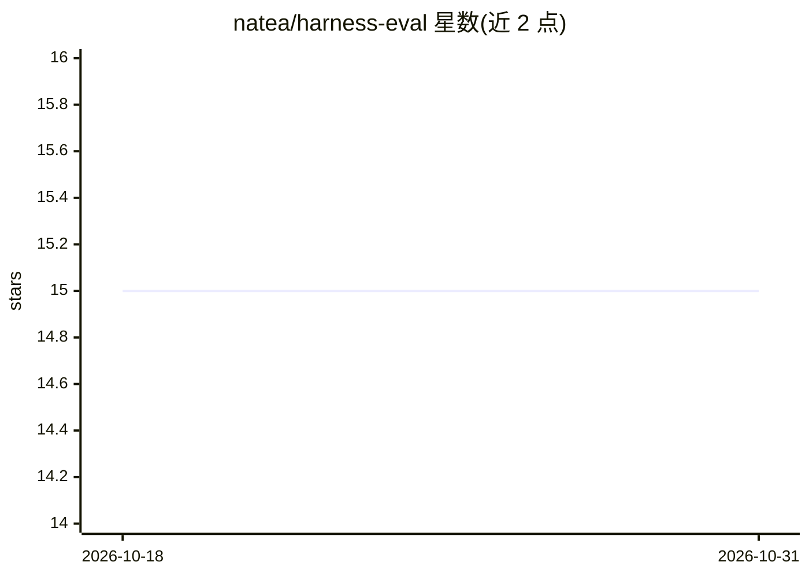

# natea/harness-eval

⭐ 15 · TypeScript · 推送 2026-07-08 · [GitHub](https://github.com/natea/harness-eval) · [官网](https://codingharness.xyz/) · 个人维护

**评测框架：让各 agentic 编码框架同规格构建并打分排名**

面向 agentic coding frameworks（Superpowers、Compound Engineering、Agent Skills、GSD）的评测框架：在隔离沙箱（Daytona/E2B/Docker/macOS VZ/worktree）中以相同 PRD、相同 harness 与模型驱动各框架构建同一产品，随后用双重评分机制打分——执行冻结测试计划并引用证据的 evaluator agent，以及在去除框架标识副本上盲评五项标准的 code-quality judge。输出 PRD 遵循度、代码质量、速度、token 花费的加权综合分与排行榜。默认经 headless Claude Code 按订阅计费运行，支持 GLM via z.ai 模型。用 Bun 构建，提供本地 dashboard 与 Eval Studio 网页界面。

## 筛选速览

| 维度 | 判定 | 备注 |
|---|---|---|
| AI 角色 | `ai-ecosystem` | LLM/agent 周边工具 |
| 许可风险 | `none` | — |
| 部署形态 | `self-host` | docker 或自建部署 |
| 模型依赖 | — | README 未给出锁定关系 |
| 硬件要求 | — | 无带数字的原话,不猜 |
| 安装摩擦 | `low` | 无编译、无系统依赖或容器化 |
| 成熟度 | `idea` | |

## 能力要点

- 相同 spec/模型/harness 下对比多个编码框架，隔离沙箱运行
- 双重评分：证据引用式测试计划执行 + 去标识盲评代码质量
- 结果含 results.json、scorecard.md、跨运行排行榜与实时重加权
- 支持多隔离 provider（Daytona/E2B/Docker/macOS VZ/worktree）与可插拔模型（GLM via z.ai 已验证）

## 适用场景

- 对比选型多个 agentic 编码框架的构建质量与成本
- 用自己的 PRD 对候选框架做可复现评测
- 查看带证据的逐步评测明细与调权重排名

## 场景标签

`模型评测` · 领域:评测与运维

## 证据(README 行号)

> L3: An evaluation framework that **definitively ranks agentic coding frameworks** by
> L84: 5. **Grading phase** — two independent instruments:

## 星数曲线

2026-10-18 15 → 2026-10-31 15（+0）

---
*卡片 v1 · prompt 1.4 · 生成 2026-10-30 · 置信度 high · 依据 README sha `84f44955c6eb` · [字段定义](../../DATASET.md)*
