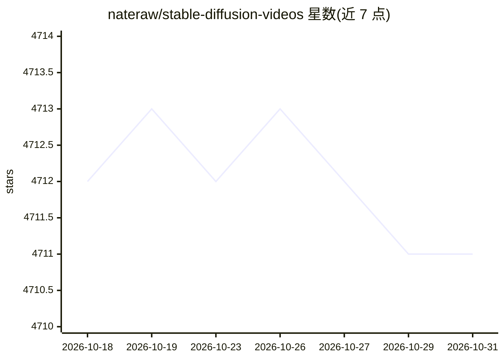

# nateraw/stable-diffusion-videos

⭐ 4,711 · Python · Apache-2.0 · 推送 2025-12-16 · [GitHub](https://github.com/nateraw/stable-diffusion-videos) · 个人维护

**用 Stable Diffusion 在文本提示间插值生成视频的库**

基于 Stable Diffusion 与 HuggingFace diffusers 的视频生成 Python 库：通过 StableDiffusionWalkPipeline 在文本提示与潜空间之间插值，生成提示间渐变（morphing）视频；支持提供音频文件，按节拍调整插值速率制作音乐视频；并提供基于 Gradio 风格 Interface 的 UI 使用方式。Apple M1 上需使用 torch.float32（float16 在 MPS 不可用）。项目基于 @karpathy 分享的脚本修改而来。

## 筛选速览

| 维度 | 判定 | 备注 |
|---|---|---|
| AI 角色 | `ai-native` | 本体是模型或模型工具 |
| 许可风险 | `permissive` | Apache-2.0 |
| 部署形态 | `library` | 以包/库形式分发 |
| 模型依赖 | — | README 未给出锁定关系 |
| 硬件要求 | — | 无带数字的原话,不猜 |
| 安装摩擦 | `low` | 无编译、无系统依赖或容器化 |
| 成熟度 | — | 结构信号不足 |

## 能力要点

- 在文本提示间潜空间插值生成渐变视频
- 提供音频路径时按节拍调整插值速率制作音乐视频
- 提供 Interface UI 使用方式
- Apple M1/MPS 需用 torch.float32

## 适用场景

- 生成两个文本提示之间的渐变视频
- 按音乐节拍制作 Stable Diffusion 音乐视频
- 在 Colab 中快速试用

## 场景标签

`视频生成` `图像生成` · 领域:内容生成

## 证据(README 行号)

> L24: from stable_diffusion_videos import StableDiffusionWalkPipeline
> L32: *New!* Music can be added to the video by providing a path to an audio file. The audio will inform the rate of inte

## 星数曲线

2026-10-18 4,712 → 2026-10-31 4,711（-1）

---
*卡片 v1 · prompt 1.4 · 生成 2026-10-20 · 置信度 high · 依据 README sha `ea067dc67df0` · [字段定义](../../DATASET.md)*
