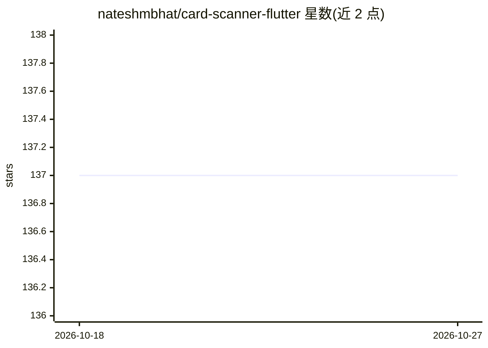

# nateshmbhat/card-scanner-flutter

⭐ 137 · Swift · GPL-3.0 · 推送 2026-04-09 · [GitHub](https://github.com/nateshmbhat/card-scanner-flutter) · [官网](https://pub.dev/packages/card_scanner) · 个人维护

**Flutter 离线银行卡扫描插件，识别卡号/有效期/持卡人**

面向 Flutter 开发者的 pub 包 card_scanner：调用 scanCard 打开设备摄像头，基于 Google 机器学习模型离线扫描信用卡/借记卡，返回 CardDetails 对象，可识别卡号、有效期、持卡人姓名与发卡机构；内置校验算法检查卡号错误，支持速度与精度参数调节。限制：iOS 最低目标版本需 >= 12.0.0，且需注释 Podfile 中 use_frameworks! 行。提供 demo 应用。

## 筛选速览

| 维度 | 判定 | 备注 |
|---|---|---|
| AI 角色 | `ai-native` | 本体是模型或模型工具 |
| 许可风险 | `viral` | GPL-3.0 |
| 部署形态 | `None` |  |
| 模型依赖 | — | README 未给出锁定关系 |
| 硬件要求 | — | 无带数字的原话,不猜 |
| 安装摩擦 | `low` | 无编译、无系统依赖或容器化 |
| 成熟度 | — | 结构信号不足 |

## 能力要点

- 完全离线扫描，无需网络
- 识别卡号、有效期、持卡人姓名与发卡机构
- 基于 Google 机器学习模型
- 卡号校验和错误自动检查，支持速度/精度参数控制

## 适用场景

- 在 Flutter 应用中扫码录入银行卡信息
- 支付流程中让用户免手动输入卡号与有效期

## 场景标签

`OCR` · 领域:感知与多模态

## 证据(README 行号)

> L7: - 🔒Fully **OFFLINE** scan makes it a completely **secure scanner** !
> L9: - 🔋Powered by Google's Machine Learning models

## 星数曲线

2026-10-18 137 → 2026-10-27 137（+0）

---
*卡片 v1 · prompt 1.4 · 生成 2026-10-22 · 置信度 high · 依据 README sha `51dd5115a019` · [字段定义](../../DATASET.md)*
