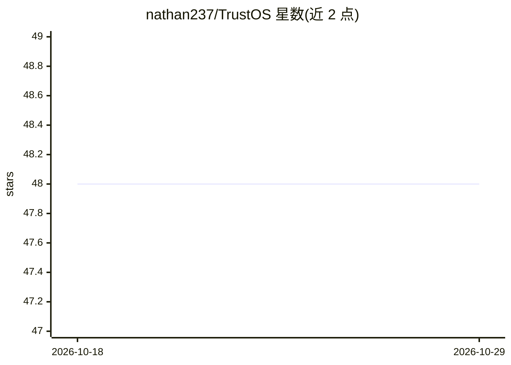

# nathan237/TrustOS

⭐ 48 · Rust · Apache-2.0 · 推送 2026-08-01 · [GitHub](https://github.com/nathan237/TrustOS) · 个人维护

**单人开发的纯 Rust 裸机操作系统，带硬件诊断与内核音频**

TrustOS 是从零编写的 100% no_std Rust 裸机操作系统，约 26.4 万行代码，无 C、无二进制固件块，可启动于真实硬件（笔记本、矿板）与 QEMU/VirtualBox。功能包括：PCI/MSR/ACPI/GPU 寄存器等硬件探测面（hwdbg 诊断命令集）、AMD GPU（RX 580X）裸机驱动、Intel HDA 音频驱动、内核内合成器与 TrustDAW 数字音频工作站、Ring 3 用户态、UDP 远程 shell/帧缓冲/内核日志。提供 ISO 下载、QEMU/USB/PXE 启动与 PowerShell 构建脚本；ARM64 实验性、RISC-V 开发中。源码以 4 个教学版本（英/法）发布。

## 筛选速览

| 维度 | 判定 | 备注 |
|---|---|---|
| AI 角色 | `ai-enhanced` | 去掉 AI 部分产品仍成立 |
| 许可风险 | `permissive` | Apache-2.0 |
| 部署形态 | `None` |  |
| 模型依赖 | — | README 未给出锁定关系 |
| 硬件要求 | — | 无带数字的原话,不猜 |
| 安装摩擦 | `medium` | 含编译或系统依赖之一 |
| 成熟度 | `idea` | |

## 能力要点

- 约 264K 行 no_std Rust，零 C、零二进制 blobs，unsafe 仅限 MMIO 边界
- hwdbg 硬件探测面：PCI/CPUID/MSR/ACPI/SMBIOS/AMD GPU/NVIDIA/HDA/EC
- 内核内音频栈：Intel HDA 驱动、8 声部合成器、效果链、TrustDAW（钢琴卷帘+WAV 导出）
- 远程优先调试：UDP 帧缓冲流、远程 shell、netconsole 内核日志

## 适用场景

- 在真机或 QEMU 上裸机探测与调试硬件（PCI/ACPI/GPU 寄存器）
- 通过 UDP 远程监视与操作无头开发板
- 学习从零编写 Rust 操作系统（4 个教学版本源码）

## 场景标签

`教程课程` · 领域:学习与行业

## 证据(README 行号)

> L28: TrustOS is a **bare-metal operating system written from scratch in Rust** — no Linux, no Mesa, no libc, no binary b

## 星数曲线

2026-10-18 48 → 2026-10-29 48（+0）

---
*卡片 v1 · prompt 1.4 · 生成 2026-10-25 · 置信度 low · 依据 README sha `af5c38d09f30` · [字段定义](../../DATASET.md)*
